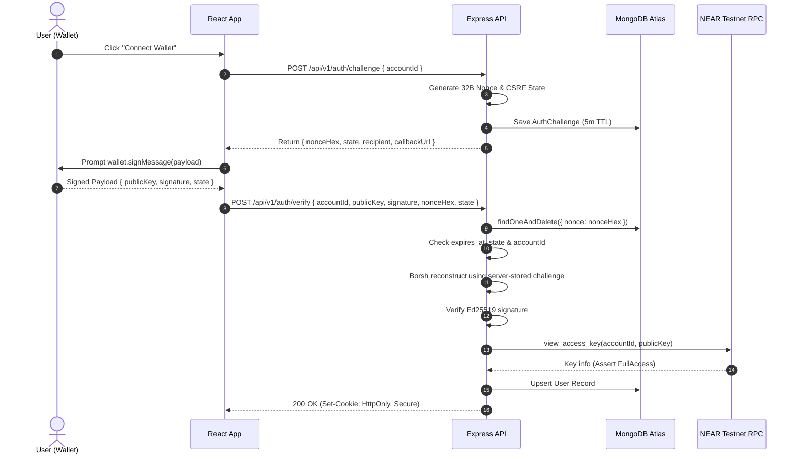
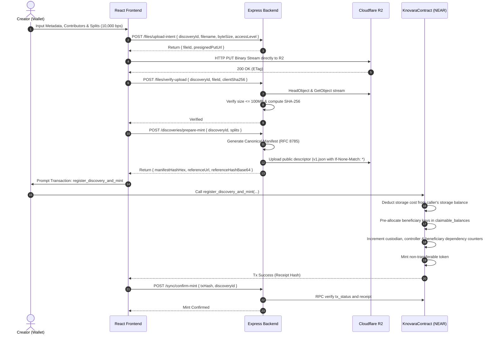

# KNOVARA System Architecture & Technical Design Document

**Product Name:** KNOVARA  
**Document Version:** 1.0.4  
**Status:** Architecture Draft — Awaiting User Approval  
**Reference Document:** KNOVARA PRD v1.1.2 (`docs/PRD.md`)  
**Target Milestone:** NEAR Hackathon 2026 (9-Day MVP Implementation)  

---

> [!NOTE]
> **Illustrative Test Data Notice:** All personas, organization names, account IDs (e.g., `erostova.testnet`, `pacific-tech.testnet`), discovery titles, sample file hashes, and manifest digests appearing throughout this document are strictly illustrative test placeholders designed for prototyping and automated test scenarios. They do not represent real-world entities, commercial partnerships, or verified cryptographic digests of production assets.

---

## 1. Architecture Overview & Core Principles

### 1.1 Architecture Philosophy
KNOVARA establishes an open, decentralized economic and cryptographic infrastructure protocol connecting innovators who document valuable discoveries with enterprises and researchers who license them. The technical architecture is structured around five core principles:

1. **On-Chain Primacy for Rights & Capital:** The NEAR smart contract is the sole authoritative ledger for token existence, custody, rights controller designation, on-chain split allocations, license statuses, terms hashes, exact payments, and claimable royalty balances. No off-chain database can override on-chain state.
2. **Strict Confidentiality of Proprietary Research:** Raw research manuscripts, datasets, CAD models, and technical formulations are never placed on-chain, never published to public IPFS/Arweave gateways, and never served via permanent public URLs. Storage in Cloudflare R2 is private by default, with access mediated exclusively via short-lived, authenticated presigned URLs.
3. **Deterministic Core Workflows:** Core registration, licensing, on-chain settlement, and file delivery operate 100% deterministically without external Large Language Model (LLM) dependencies. AI assistants are layered as optional, non-blocking query helpers.
4. **Complete Non-Transferability of Passports:** In the MVP, the Discovery Rights Passport NFT (NEP-171) is strictly non-transferable across all transfer vectors (`nft_transfer`, `nft_transfer_call`, and approval mechanisms). Token custody is permanently decoupled from the licensing authority (`rights_controller_id`) and revenue shares (`beneficiary_splits`).
5. **Exact Payment & Safe Pull Settlement:** All licensing fees are transacted in native testnet NEAR at exact integer yoctoNEAR values. Royalties are settled using the Pull-Payment pattern with asynchronous promise callbacks that safely restore claimable balances if cross-account transfers fail.

---

## 2. System Context & Component Architecture

### 2.1 System Context Diagram

```
+──────────────────────────────────────────────────────────────────────────────────────────+
|                                      EXTERNAL ACTORS                                     |
|  - Discovery Creators (Scientists, Engineers, Collaborative Research Teams)              |
|  - Rights Controllers (University TTOs, Corporate IP Legal Teams, Solo Inventors)         |
|  - Enterprise Buyers (AI Model Developers, Biotech Labs, Industrial Corporations)        |
+────────────────────────────────────────────┬─────────────────────────────────────────────+
                                             │
                       HTTPS / WSS           │ Wallet Signatures (HOT Connect / NEP-413)
                                             ▼
+──────────────────────────────────────────────────────────────────────────────────────────+
|                                    KNOVARA FRONTEND (Vercel)                             |
|  - React 18 SPA (Vite, JavaScript ES Modules, Regular CSS)                              |
|  - @hot-labs/near-connect (Filtered for testnet, signMessage, signAndSendTransaction)    |
|  - Client-side Byte-Level SHA-256 Hashing (Web Crypto API)                               |
|  - Direct-to-R2 Presigned Binary Upload Engine                                           |
+────────────────────────────────────────────┬─────────────────────────────────────────────+
                                             │
                       REST API (JSON)       │ Authenticated Session (HttpOnly Cookie)
                                             ▼
+──────────────────────────────────────────────────────────────────────────────────────────+
|                                    KNOVARA BACKEND (Render)                              |
|  - Node.js 24 LTS Runtime (>=24.0.0 <25.0.0) + Express.js (Native ES Modules)            |
|  - NEP-413 Borsh Signature Verification & Session Manager                                |
|  - Canonical Evidence Manifest Generator (RFC 8785 JCS)                                  |
|  - Scoped File Access Policy Engine & Presigned S3/R2 URL Token Issuer                   |
|  - On-Chain Event & Transaction Reconciler (NEAR RPC Poller)                             |
+────────────────────┬───────────────────────────────────────┬─────────────────────────────+
                     │                                       │
       Mongoose /    │                         S3 API        │
       BSON Protocol │                         (TLS)         │
                     ▼                                       ▼
+───────────────────────────────+     +────────────────────────────────────────────────────+
|   MONGODB ATLAS CLOUD DB      |     |              CLOUDFLARE R2 OBJECT STORAGE          |
|  - Users & Auth Challenges    |     |  - Private Evidence Bucket (Encrypted at Rest)     |
|  - Discovery Metadata & Lineage|    |  - Authoritative License Terms Bucket (`terms/...`)|
|  - License Terms Cache & Reqs |     |  - Public-Safe Metadata Bucket (`v1.json`)         |
|  - Chain Tx Sync Checkpoints  |     +────────────────────────────────────────────────────+
|  - Keyword & Category Indexes |
+───────────────────────────────+
                     │
                     │ JSON-RPC 2.0 (HTTPS)
                     ▼
+──────────────────────────────────────────────────────────────────────────────────────────+
|                                  NEAR PROTOCOL (Testnet)                                 |
|  - KNOVARA Core Contract (`knovara.testnet`)                                             |
|    * NEP-171 Non-Transferable Passport NFT Engine                                        |
|    * NEP-177 Metadata Standard Reference & Reference Hash                                |
|    * NEP-145 Storage Management with Dynamic Bounds & Dependency Tracking                |
|    * Beneficiary Storage Pre-Allocation Enforcer                                         |
|    * Granular Licensing & Fixed 32-Byte Terms Hash State Machine                         |
|    * Exact Attached-Deposit Escrow & Integer yoctoNEAR Split Accounting                  |
|    * Pull-Payment Claimable Balances with Asynchronous Callback Rollback                 |
+──────────────────────────────────────────────────────────────────────────────────────────+
```

### 2.2 Component Responsibilities & Authoritative Trust Matrix

| Data Domain | Authoritative Master | Secondary / Projection | Sync Mechanism | Conflict Resolution Rule |
| :--- | :--- | :--- | :--- | :--- |
| **Passport Existence & Token ID** | **NEAR Smart Contract** | MongoDB `discoveries` | Mint receipt hash & RPC poller | On-chain state is final; unconfirmed MongoDB records remain `PENDING_CONFIRMATION`. |
| **NFT Custodian (`owner_id`)** | **NEAR Smart Contract** | MongoDB `discoveries` | Query `nft_token(token_id)` | Contract state overrides MongoDB. In MVP, permanently non-transferable. |
| **Rights Controller ID** | **NEAR Smart Contract** | MongoDB `discoveries` | Query `get_discovery(token_id)` | Contract `rights_controller_id` is authoritative. Backend cannot reassign. |
| **Beneficiary Splits (bps)** | **NEAR Smart Contract** | MongoDB `discoveries` | On-chain splits table | On-chain splits table dictates payouts. Exact 10,000 bps invariant enforced by contract. |
| **License Terms Hash** | **NEAR Smart Contract** | MongoDB `license_terms` | Embedded in `LicenseRecordInternal` | Contract 32-byte digest is binding. Rejects payment if buyer terms mismatch. |
| **License Terms Content** | **Cloudflare R2 (Raw Bytes)**| MongoDB `license_terms` | Content-addressed SHA-256 | R2 raw bytes are authoritative master. MongoDB is cache projection. |
| **License Status (Active/Paid)** | **NEAR Smart Contract** | MongoDB `licenses` | `pay_license` receipt | Backend issues presigned download URLs **only after** verifying active status on-chain. |
| **Claimable Balances** | **NEAR Smart Contract** | None (Real-time view) | Query `get_claimable_balance` | Never stored or cached in MongoDB. Read directly from NEAR RPC. |
| **Extended Abstract & Bio** | **MongoDB Atlas** | None | Direct user submission | Application-level rich metadata. Not required for on-chain consensus. |
| **Raw Evidence Files** | **Cloudflare R2** | MongoDB manifest | SHA-256 digest match | Canonical manifest bytes hashed to `evidence_manifest_hash` on NEAR. |

---

## 3. Dependency & Environment Compatibility Specification

### 3.1 Inspected Development Environment & Node.js 24 LTS Strategy
The development workspace has been verified with the following tools:
- **Rust Compiler (`rustc`):** `1.95.0 (59807616e 2026-04-14)` (Verified via terminal `rustc -V`).
- **Cargo:** `1.95.0 (f2d3ce0bd 2026-03-21)`.
- **Wasm Target:** `wasm32-unknown-unknown` is installed and verified.
- **Inspected Local Container Runtime:** Node.js `v20.20.2` (Verified via terminal `node -v`).

> [!IMPORTANT]
> **Node.js 24 LTS Runtime Standardization:**  
> Node.js 20.x reached End-of-Life (EOL) on **April 30, 2026**. While the initial development container runs legacy Node `v20.20.2`, the KNOVARA project standardizes strictly and exclusively on **Node.js 24 LTS (`>=24.0.0 <25.0.0`)** across all development, CI/CD, and production environments:
> - **`.nvmrc`:** `24`
> - **`package.json` engines:** `"node": ">=24.0.0 <25.0.0"`, `"npm": ">=10.0.0"`
> - **Render Deployment:** Configured with `NODE_VERSION: "24"`
> - **Vercel Deployment:** Configured via `package.json` engine constraint to Node.js 24 LTS.
> - **Local Development:** Developers must switch to Node 24 (`nvm use 24`) prior to Step 3 implementation.
> All legacy references to Node 20 or Node 22 compatibility targets are permanently removed.

### 3.2 Dependency Compatibility Matrix

| Package / Tool | Verified Version | Category | Purpose | Compatibility Notes & Documentation Reference |
| :--- | :--- | :--- | :--- | :--- |
| **`near-sdk`** | `5.30.1` | Smart Contract | Core NEAR Rust SDK | Requires Rust $\ge 1.95.0$ (Verified). Supports `nearcore 2.14`, modern `#[near]` macros, and modern `near_sdk::store` collections. Release 5.30.1 fixes nested `store` collection flush prior to storage usage measurement. [crates.io/crates/near-sdk/5.30.1](https://crates.io/crates/near-sdk) |
| **`near-contract-standards`** | `5.30.1` | Smart Contract | NEP-171 / NEP-177 | Official standards library released alongside `near-sdk 5.30.1`. Provides base types for NEP-171, NEP-177, and NEP-145. [crates.io/crates/near-contract-standards/5.30.1](https://crates.io/crates/near-contract-standards) |
| **`near-workspaces`** | `0.24.0` | Testing | Sandbox Integration | Contract sandbox integration testing in Rust. Fully compatible with `near-sdk 5.30.1`. [crates.io/crates/near-workspaces](https://crates.io/crates/near-workspaces) |
| **`@hot-labs/near-connect`** | `^0.11.4` | Frontend | NEAR Wallet Connector | Sandboxed iframe connector. Supports `features: { signMessage: true, testnet: true, signAndSendTransaction: true }`. [github.com/azbang/near-connect](https://github.com/azbang/near-connect) |
| **`near-api-js`** | `^5.0.0` | Backend / Frontend | NEAR RPC & Crypto | Provides Borsh serialization schemas, Ed25519 key verification, and NEAR RPC providers. [github.com/near/near-api-js](https://github.com/near/near-api-js) |
| **`borsh`** | `^2.0.0` | Backend | Binary Deserialization | Fast binary serialization required to construct canonical NEP-413 payload bytes. [github.com/near/borsh-js](https://github.com/near/borsh-js) |
| **`mongoose`** | `^8.9.2` | Backend | MongoDB ODM | Selected over raw `mongodb` driver. Provides strict schema validation, automatic index creation, built-in TTL indexes, and model hooks. Fully compatible with Node 24. [mongoosejs.com](https://mongoosejs.com) |
| **`@aws-sdk/client-s3`** | `^3.723.0` | Backend | Cloudflare R2 Client | S3-compatible client for R2 upload intents, metadata verification, and conditional `PutObject`. [docs.aws.amazon.com/AWSJavaScriptSDK/v3](https://docs.aws.amazon.com/AWSJavaScriptSDK/v3/) |
| **`@aws-sdk/s3-request-presigner`**| `^3.723.0` | Backend | Presigned URL Issuer | Generates short-lived presigned PUT and GET URLs for R2 objects. |
| **`canonicalize`** | `^2.0.0` | Backend | Canonical JSON | Standard RFC 8785 JSON Canonicalization Scheme (JCS) generator for evidence manifests. [github.com/cyberphone/canonicalize](https://github.com/cyberphone/canonicalize) |
| **`express`** | `^4.21.2` | Backend | HTTP API Server | Industry-standard Node.js web framework running in native ES module mode under Node 24 LTS. |
| **`cookie-parser`** | `^1.4.7` | Backend | Session Security | Parses secure, signed `HttpOnly` session cookies. |
| **`cors`** | `^2.8.5` | Backend | CORS Enforcement | Enforces origin whitelisting between Vercel frontend and Render backend. |
| **`react`** | `^18.3.1` | Frontend | UI Library | React 18 LTS selected for maximum ecosystem compatibility with web3 wallet connectors and sandboxed iframe adapters. |
| **`vite`** | `^6.0.7` | Frontend | Build Tooling | High-performance SPA bundler running in native ES module mode. |

---

## 4. Smart Contract Architecture & Rust Module Design

### 4.1 Single Unified Contract Topology
To avoid asynchronous cross-contract call complexity, gas prepayment estimation failures, and multi-receipt rollback hazards within a 9-day development period, KNOVARA deploys a **single unified contract** organized into clean Rust modules:

```
contracts/knovara/
├── Cargo.toml                  # near-sdk 5.30.1, near-contract-standards 5.30.1
└── src/
    ├── lib.rs                  # Contract state struct, initialization, and public entrypoints
    ├── nft.rs                  # NEP-171 Non-Transferable core, NEP-177 metadata & view methods
    ├── discovery.rs            # Registration, lineage DAG, and metadata reference tracking
    ├── licensing.rs            # Offers, requests, approvals, terms hash validation, expiration
    ├── payments.rs             # Attached deposit checks, yoctoNEAR splits math, pull withdrawals
    ├── storage.rs              # NEP-145 Storage Management with AccountDependencyCounts
    └── events.rs               # NEP-297 compliant event logging (nft_mint, license_paid, etc.)
```

> [!NOTE]
> **Architectural Reference Code:** Smart contract code snippets in this architecture document are formal architectural reference specifications defining method signatures, data structures, and state transition logic. Implementation compilation and comprehensive unit test verification will be executed during Step 3.

### 4.2 Modern Rust Collection Selection (`near_sdk::store`)
In `near-sdk 5.30.1`, the old `near_sdk::collections` module is deprecated. Furthermore, `near_sdk::store::UnorderedMap` is deprecated in modern documentation. KNOVARA strictly adopts **modern `near_sdk::store::LookupMap`**:
- **`near_sdk::store::LookupMap`:** Used for all primary key-value storage where iteration is not required (`tokens_by_id`, `token_metadata_by_id`, `discovery_to_token`, `license_records`, `license_offers`, `claimable_balances`, `storage_balances`, `account_dependency_counts`).
- **NEP-181 Enumeration Deferral Justification:** NEP-181 pagination methods (`nft_tokens`, `nft_tokens_for_owner`) are deliberately omitted from the P0 smart contract. Performing unbounded or paginated table iterations directly on-chain creates substantial gas consumption and storage hazard overhead as the discovery catalog grows. Instead, full catalog browsing, full-text search, and owner token filtering are offloaded to MongoDB Atlas projections, which are continuously synchronized with on-chain receipts.
- **Benefits:** Deserialization caching, automatic dirty-checking, write-back on drop, and typed storage prefixes.
- **Storage Keys:** Defined using a strongly typed `StorageKey` enum implementing `BorshSerialize` and `BorshStorageKey`.

```rust
// Cargo.toml configuration:
// [dependencies]
// near-sdk = { version = "5.30.1", features = ["unit-testing"] }
// near-contract-standards = "5.30.1"
// hex = { version = "0.4.3", default-features = false, features = ["alloc"] }

use near_sdk::borsh::{self, BorshDeserialize, BorshSerialize};
use near_sdk::json_types::{Base64VecU8, U128, U64};
use near_sdk::store::LookupMap;
use near_sdk::{near, AccountId, PanicOnDefault, Timestamp, NearToken, BorshStorageKey};
use near_contract_standards::non_fungible_token::metadata::NFTContractMetadata;

#[derive(BorshSerialize, BorshStorageKey)]
#[near]
pub enum StorageKey {
    TokensById,
    TokenMetadataById,
    DiscoveryToToken,
    LicenseRecords,
    LicenseOffers,
    ClaimableBalances,
    StorageBalances,
    AccountDependencyCounts,
    LineageParents,
}
```

### 4.3 State Storage Structs & Internal Data Types (`src/lib.rs`)

To guarantee cryptographic integrity and prevent data type ambiguities, all cryptographic digests are stored strictly as **fixed 32-byte arrays (`[u8; 32]`)** in contract storage. Monetary values are stored as native **`u128`** integers. Boundary JSON view structs serialize digests to 64-character lowercase hexadecimal strings and monetary amounts to `U128` decimal strings.

```rust
// -------------------------------------------------------------
// INTERNAL STORAGE STRUCTS (Serialized via Borsh)
// -------------------------------------------------------------

#[near(serializers=[borsh])]
#[derive(Clone)]
pub struct BeneficiaryShare {
    pub account_id: AccountId,
    pub basis_points: u16, // 1 to 10000; Sum across vector MUST == 10000
}

#[near(serializers=[borsh, json])]
#[derive(Clone, PartialEq, Eq, Debug)]
pub enum LicenseScope {
    AcademicResearch,
    CommercialUse,
    AiModelTraining,
    AiModelFineTuning,
    AiKnowledgeRetrieval,
    ResearchEvaluation,
    CustomTerms,
}

#[near(serializers=[borsh, json])]
#[derive(Clone, PartialEq, Eq, Debug)]
pub enum LicenseStatus {
    Requested,
    Approved { payment_deadline: Timestamp },
    Rejected { reason: String },
    Active { activated_at: Timestamp, expires_at: Timestamp },
    Expired,
}

#[near(serializers=[borsh])]
#[derive(Clone)]
pub struct LicenseOfferInternal {
    pub scope: LicenseScope,
    pub price_yocto: u128,
    pub terms_hash: [u8; 32], // Fixed 32-byte SHA-256 digest
    pub is_active: bool,
}

#[near(serializers=[borsh])]
#[derive(Clone)]
pub struct LicenseRecordInternal {
    pub license_id: String,
    pub discovery_id: String,
    pub token_id: String,
    pub buyer_id: AccountId,
    pub scope: LicenseScope,
    pub price_yocto: u128,
    pub duration_days: u32,
    pub license_terms_hash: [u8; 32], // Fixed 32-byte SHA-256 digest
    pub accepted_terms_hash: Option<[u8; 32]>, // Fixed 32-byte digest upon activation
    pub status: LicenseStatus,
}

#[near(serializers=[borsh])]
#[derive(Clone)]
pub struct DiscoveryRecordInternal {
    pub discovery_id: String,
    pub token_id: String,
    pub custodian_id: AccountId,
    pub rights_controller_id: AccountId,
    pub evidence_manifest_hash: [u8; 32], // Fixed 32-byte SHA-256 digest
    pub beneficiary_splits: Vec<BeneficiaryShare>,
    pub registered_at: Timestamp,
    pub lineage_parents: Vec<String>,
}

#[near(serializers=[borsh])]
#[derive(Clone)]
pub struct StorageBalanceInternal {
    pub total: u128,     // Total storage deposit credited
    pub available: u128, // Liquid, withdrawable storage deposit
}

#[near(serializers=[borsh])]
#[derive(Clone, Default)]
pub struct AccountDependencyCounts {
    pub custodian_count: u32,             // Discoveries where account is custodian
    pub rights_controller_count: u32,     // Discoveries where account is rights controller
    pub beneficiary_reference_count: u32, // Discoveries where account is in beneficiary_splits
    pub persistent_license_count: u32,    // Storage-funded license records where account is buyer
    pub active_license_count: u32,        // Currently active licenses where account is buyer
}

#[near(contract_state)]
#[derive(PanicOnDefault)]
pub struct KnovaraContract {
    pub admin_id: AccountId,
    pub tokens_count: u64,
    pub storage_min_deposit: u128, // Measured and stored dynamically during contract initialization
    pub tokens_by_id: LookupMap<String, DiscoveryRecordInternal>,
    pub token_metadata_by_id: LookupMap<String, TokenMetadata>,
    pub discovery_to_token: LookupMap<String, String>,
    pub license_records: LookupMap<String, LicenseRecordInternal>,
    pub license_offers: LookupMap<String, LicenseOfferInternal>, // Key: "{token_id}:{scope_index}"
    pub claimable_balances: LookupMap<AccountId, u128>,
    pub storage_balances: LookupMap<AccountId, StorageBalanceInternal>,
    pub account_dependency_counts: LookupMap<AccountId, AccountDependencyCounts>,
    pub contract_metadata: NFTContractMetadata,
}

// -------------------------------------------------------------
// EXTERNAL BOUNDARY VIEW STRUCTS (Serialized via JSON)
// -------------------------------------------------------------

#[near(serializers=[json])]
pub struct LicenseOfferView {
    pub scope: LicenseScope,
    pub price_yocto: U128,
    pub terms_hash: String, // 64 lowercase hex characters
    pub is_active: bool,
}

#[near(serializers=[json])]
pub struct LicenseRecordView {
    pub license_id: String,
    pub discovery_id: String,
    pub token_id: String,
    pub buyer_id: AccountId,
    pub scope: LicenseScope,
    pub price_yocto: U128,
    pub duration_days: u32,
    pub license_terms_hash: String, // 64 lowercase hex characters
    pub accepted_terms_hash: Option<String>, // 64 lowercase hex characters
    pub status: LicenseStatus,
}

#[near(serializers=[json])]
pub struct DiscoveryRecordView {
    pub discovery_id: String,
    pub token_id: String,
    pub custodian_id: AccountId,
    pub rights_controller_id: AccountId,
    pub evidence_manifest_hash: String, // 64 lowercase hex characters
    pub beneficiary_splits: Vec<BeneficiaryShare>,
    pub registered_at: Timestamp,
    pub lineage_parents: Vec<String>,
}

// -------------------------------------------------------------
// CRYPTOGRAPHIC DIGEST UTILITIES
// -------------------------------------------------------------

pub fn parse_hex_32(hex_str: &str) -> [u8; 32] {
    near_sdk::require!(hex_str.len() == 64, "ERR_INVALID_HEX_LENGTH");
    let mut arr = [0u8; 32];
    hex::decode_to_slice(hex_str, &mut arr).expect("ERR_INVALID_HEX_CHARS");
    arr
}

pub fn to_hex_32(bytes: &[u8; 32]) -> String {
    hex::encode(bytes)
}
```

### 4.4 Complete NEP-171, NEP-177 & Non-Transferability Engine (`src/nft.rs`)

To guarantee complete non-transferability while preserving full NEP-171 read compatibility, all transfer and approval paths are strictly blocked:

```rust
// In src/nft.rs:
#[near]
impl KnovaraContract {
    // -------------------------------------------------------------
    // NEP-171 TRANSFER GUARDS: Explicitly Revert All Custody Transfers
    // -------------------------------------------------------------
    #[payable]
    pub fn nft_transfer(
        &mut self,
        receiver_id: AccountId,
        token_id: String,
        approval_id: Option<u64>,
        memo: Option<String>,
    ) {
        near_sdk::assert_one_yocto();
        near_sdk::env::panic_str("ERR_PASSPORT_NON_TRANSFERABLE: Custodial transfer of KNOVARA Rights Passports is permanently disabled in MVP.");
    }

    #[payable]
    pub fn nft_transfer_call(
        &mut self,
        receiver_id: AccountId,
        token_id: String,
        approval_id: Option<u64>,
        memo: Option<String>,
        msg: String,
    ) -> near_sdk::PromiseOrValue<bool> {
        near_sdk::assert_one_yocto();
        near_sdk::env::panic_str("ERR_PASSPORT_NON_TRANSFERABLE: Custodial transfer of KNOVARA Rights Passports is permanently disabled in MVP.");
    }

    // -------------------------------------------------------------
    // NEP-178 APPROVAL MANAGEMENT GUARDS: Block All Proxy Transfers
    // -------------------------------------------------------------
    #[payable]
    pub fn nft_approve(&mut self, token_id: String, account_id: AccountId, msg: Option<String>) {
        near_sdk::assert_one_yocto();
        near_sdk::env::panic_str("ERR_APPROVALS_NOT_SUPPORTED: NEP-178 transfer approvals are disabled for soulbound passports.");
    }

    #[payable]
    pub fn nft_revoke(&mut self, token_id: String, account_id: AccountId) {
        near_sdk::assert_one_yocto();
        near_sdk::env::panic_str("ERR_APPROVALS_NOT_SUPPORTED: NEP-178 transfer approvals are disabled.");
    }

    #[payable]
    pub fn nft_revoke_all(&mut self, token_id: String) {
        near_sdk::assert_one_yocto();
        near_sdk::env::panic_str("ERR_APPROVALS_NOT_SUPPORTED: NEP-178 transfer approvals are disabled.");
    }

    // -------------------------------------------------------------
    // NEP-171 & NEP-177 VIEW METHODS: Fully Supported & Standardized
    // -------------------------------------------------------------
    pub fn nft_token(&self, token_id: String) -> Option<JsonToken> {
        let discovery = self.tokens_by_id.get(&token_id)?;
        let metadata = self.token_metadata_by_id.get(&token_id)?;
        Some(JsonToken {
            token_id,
            owner_id: discovery.custodian_id.clone(),
            metadata: Some(metadata.clone()),
            approved_account_ids: Some(std::collections::HashMap::new()), // Always empty
        })
    }

    pub fn nft_metadata(&self) -> NFTContractMetadata {
        self.contract_metadata.clone()
    }

    pub fn nft_total_supply(&self) -> U128 {
        U128(self.tokens_count as u128)
    }
}
```

### 4.5 NEP-145 Storage Management & Account Dependency Tracking (`src/storage.rs`)

The contract implements standard **NEP-145 Storage Management** with precise dynamic measurement, failure callbacks, and $O(1)$ dependency tracking:

```rust
#[near(serializers=[borsh, json])]
pub struct StorageBalance {
    pub total: U128,
    pub available: U128,
}

#[near(serializers=[borsh, json])]
pub struct StorageBalanceBounds {
    pub min: U128,
    pub max: Option<U128>,
}
```

#### 1. Dynamic Measurement of Registration Storage Minimum
The registration minimum deposit is not hardcoded or estimated through trie arithmetic. During contract initialization (`new`), the contract executes an exact SDK storage measurement:
1. Constructs a valid, conservative maximum-length AccountId (64 characters: `"benchmark-measurement-account-for-storage-bounds-64-characters.testnet"`).
2. Flushes the storage collection to clear dirty buffers: `self.storage_balances.flush()`.
3. Records `initial_bytes = env::storage_usage()`.
4. Inserts a benchmark record: `self.storage_balances.insert(benchmark_account.clone(), StorageBalanceInternal { total: 0, available: 0 })`.
5. Flushes again: `self.storage_balances.flush()`.
6. Measures exact byte delta: `measured_bytes = env::storage_usage().checked_sub(initial_bytes).expect("ERR_STORAGE_MEASURE")`.
7. Calculates the minimum deposit: `self.storage_min_deposit = (measured_bytes as u128) * env::storage_byte_cost().as_yoctonear()`.
8. Removes the benchmark record: `self.storage_balances.remove(&benchmark_account)`.
9. Flushes collections to ensure zero leftover state overhead.
10. `storage_balance_bounds(&self)` returns `{ min: U128(self.storage_min_deposit), max: None }`.

#### 2. `storage_deposit` with Refund Failure Callback
- **Account Identification:** If `account_id` is supplied, credits `account_id`. If omitted, credits `env::predecessor_account_id()`.
- **First-Time Registration:** If the target account is not registered, attached deposit must be $\ge \text{self.storage_min_deposit}$. The contract creates the entry in `storage_balances` and an initialized `AccountDependencyCounts` entry.
- **`registration_only` Refund Handling:**
  - If already registered and `registration_only == Some(true)`: The contract takes 0 additional deposit and dispatches a Promise refunding the entire attached deposit to the predecessor.
  - If newly registered and `registration_only == Some(true)`: The contract credits `self.storage_min_deposit` to the account and dispatches a Promise refunding any excess attached deposit above `min` to the predecessor.
  - If `registration_only` is false or omitted: Full attached deposit is credited to the account's `storage_balances` (`total` and `available`).
- **Asynchronous Refund Failure Callback:** Every refund promise attaches a private callback `on_storage_refund_callback(account_id: AccountId, amount: U128)`. If the refund transfer promise fails, the callback credits `amount.0` back into `storage_balances[account_id].available` (and `total`), guaranteeing zero untracked or lost funds.

#### 3. `storage_withdraw`
- Requires attached deposit of **exactly 1 yoctoNEAR** (`near_sdk::assert_one_yocto()`).
- **Omitted Amount Behavior:** If `amount` is omitted (`None`), it withdraws the **entire** available balance (`available`), strictly consistent with NEP-145 specification. If an amount is supplied, it asserts `amount.0 <= available`.
- Permits withdrawal strictly from `available` funds.
- Does **not** modify or delete any user discovery, token, or dependency data.
- Deducts `amount` from `available` while keeping `total` unchanged upon dispatching the transfer promise.
- If the transfer fails in the private callback `on_storage_withdraw_callback`, `available` is restored:
  $$\text{storage\_balances}[\text{caller}].\text{available} \mathrel{+}= \text{withdrawn\_amount}$$

#### 4. `storage_unregister` & Account Dependency Rules
- Requires attached deposit of **exactly 1 yoctoNEAR**.
- If the account is **not registered**, returns `false` and refunds the 1 yoctoNEAR.
- **Forced Unregistration Rejected:** Forced unregistration (`force: true`) is **strictly unsupported** in P0 and panics with `ERR_FORCE_UNREGISTER_UNSUPPORTED` to prevent state dependencies or persistent storage from becoming orphaned.
- **$O(1)$ Dependency Check via `AccountDependencyCounts`:**  
  Because collections are non-iterable `LookupMap` instances, the contract queries `self.account_dependency_counts.get(&caller)` in $O(1)$ time. An account is eligible for unregistration **only** if all dependency counters are zero:
  $$\text{custodian\_count} == 0 \land \text{rights\_controller\_count} == 0 \land \text{beneficiary\_reference\_count} == 0 \land \text{persistent\_license\_count} == 0 \land \text{active\_license\_count} == 0$$
  and has zero claimable balance (`claimable_balances.get(&caller).copied().unwrap_or(0) == 0`).
- **Persistent License Record Policy:** Expired and rejected license records remain persistent on-chain records. Therefore, an account whose storage-funded records still occupy contract storage cannot unregister or receive a storage refund. Accounts remain registered until their persistent records are safely removed via future protocol features.
- If all counters are zero and no claimable balance exists, the account's `storage_balances` and `account_dependency_counts` entries are removed, and the full eligible deposit is refunded via transfer promise (with callback rollback restoring records if the refund transfer fails). Returns `true`.

#### 5. Exact Counter Transition Lifecycle Table

| Lifecycle Transition | Contract Method | Counter Mutation Details |
| :--- | :--- | :--- |
| **Discovery Registration** | `register_discovery_and_mint` | - `custodian_count += 1` for `custodian_id`<br>- `rights_controller_count += 1` for `rights_controller_id`<br>- For every beneficiary $B$ in splits: `beneficiary_reference_count += 1` |
| **License Request Created** | `request_license` | - `persistent_license_count += 1` for buyer `buyer_id` (storage allocated for record) |
| **License Request Approved** | `approve_license_request` | - Counters unchanged (record remains persistent; awaiting payment) |
| **License Request Rejected** | `reject_license_request` | - Counters unchanged (`persistent_license_count` remains 1; rejected record persists) |
| **Approved Request Expired** | `expire_license_request` | - Counters unchanged (`persistent_license_count` remains 1; expired record persists) |
| **License Payment Activated** | `pay_license` | - `active_license_count += 1` for buyer `buyer_id` (`persistent_license_count` remains 1) |
| **Active License Expired** | `expire_license` | - `active_license_count -= 1` for buyer `buyer_id` (`persistent_license_count` remains 1) |

### 4.6 Enforceable Beneficiary Pre-Allocation Architecture (`src/payments.rs`)

To guarantee that `pay_license` never reverts due to storage expansion and never double-bills buyers for contract state:
1. **Registration-Time Pre-Allocation:** During `register_discovery_and_mint`, the contract iterates through every beneficiary in `beneficiary_splits` and the `rights_controller_id`:
   - Checks if `claimable_balances.contains_key(&account_id)`.
   - If missing, inserts an initial zero-balance entry: `claimable_balances.insert(account_id, 0)`.
   - The storage bytes required for these map entries are measured dynamically and deducted from the **registrant's** available storage balance.
2. **Strict Payment Path Assertion:** When `pay_license` executes, it **strictly forbids** creating new map keys:
   ```rust
   // In src/payments.rs:
   for share in &discovery.beneficiary_splits {
       let share_amount = total_price
           .checked_mul(share.basis_points as u128).expect("ERR_SPLIT_OVERFLOW")
           .checked_div(10_000).expect("ERR_DIV_BY_ZERO");
       allocated = allocated.checked_add(share_amount).expect("ERR_ALLOCATION_OVERFLOW");

       // STRICT ASSERTION: Beneficiary entry MUST pre-exist
       let cur = self.claimable_balances.get(&share.account_id)
           .copied()
           .expect("ERR_BENEFICIARY_ENTRY_NOT_PREALLOCATED");

       self.claimable_balances.insert(share.account_id.clone(), cur.checked_add(share_amount).unwrap());
   }

   let remainder = total_price.checked_sub(allocated).expect("ERR_REMAINDER_UNDERFLOW");
   if remainder > 0 {
       // STRICT ASSERTION: Rights controller entry MUST pre-exist
       let cur_rc = self.claimable_balances.get(&discovery.rights_controller_id)
           .copied()
           .expect("ERR_RIGHTS_CONTROLLER_ENTRY_NOT_PREALLOCATED");

       self.claimable_balances.insert(discovery.rights_controller_id.clone(), cur_rc.checked_add(remainder).unwrap());
   }
   ```
   If any beneficiary entry is missing, the payment operation reverts immediately with `ERR_BENEFICIARY_ENTRY_NOT_PREALLOCATED` before any royalty accounting is completed.

### 4.7 Rigorous Storage Solvency Accounting

To prevent double-counting storage capital, the contract distinguishes between:
1. **Committed Storage Capital:** Native NEAR locked by the NEAR protocol to support state:
   $$\text{Locked Storage Balance} = \text{env::storage_usage()} \times \text{env::storage_byte_cost()}$$
2. **Available NEP-145 Deposits:** Refundable user deposits that have not yet been consumed by state writes:
   $$\text{Available Storage Liabilities} = \sum_{A} \text{storage\_balances}[A].\text{available}$$
3. **Claimable Royalty Liabilities:** Outstanding royalty balances awaiting pull withdrawal:
   $$\text{Royalty Liabilities} = \sum_{A} \text{claimable\_balances}[A]$$

> [!IMPORTANT]
> **Storage Solvency Formula (No Double-Counting):**  
> The used portion of a user's deposit ($\text{total} - \text{available}$) is already locked in `env::storage_usage() * env::storage_byte_cost()`. Adding `total` would double-count that capital. Therefore, the exact solvency formula enforced by the contract is:
> $$\text{env::account_balance()} \ge (\text{env::storage_usage()} \times \text{env::storage_byte_cost()}) + \sum_{A} \text{storage\_balances}[A].\text{available} + \sum_{A} \text{claimable\_balances}[A]$$

### 4.8 Method Specification Table

| Method Name | Visibility & Caller | Attached Deposit | Inputs & Validation Rules | State Transitions | Emitted NEP-297 Event |
| :--- | :--- | :--- | :--- | :--- | :--- |
| `new` | Public (Deployer once) | 0 | `admin_id: AccountId`. Reverts if initialized. | Initializes storage maps, metadata, dynamic bounds (measured via 64-char AccountId), and admin. | None |
| `storage_deposit` | Public (Anyone) | $\ge \text{storage\_min\_deposit}$ | `account_id: Option<AccountId>`, `registration_only: Option<bool>`. | Registers account or credits storage balance. Refunds full deposit if already registered with `registration_only: true`; refunds excess if newly registered with `registration_only: true`. Failure callback restores balance on error. | `StorageDeposit` |
| `storage_withdraw` | Public (Registered) | 1 yoctoNEAR | `amount: Option<U128>`. Omitted amount withdraws entire available balance. Reverts if amount > available balance. | Decrements available balance; transfers native NEAR with callback rollback. Leaves account data intact. | `StorageWithdraw` |
| `storage_balance_of` | Public (View) | 0 | `account_id: AccountId` | Returns `Option<StorageBalance>`. | None |
| `storage_balance_bounds` | Public (View) | 0 | None | Returns dynamically measured bounds: `{ min: U128(storage_min_deposit), max: None }`. | None |
| `storage_unregister` | Public (Registered) | 1 yoctoNEAR | `force: Option<bool>`. Reverts if dependency counts $> 0$ or `force == true`. | Removes account from `storage_balances` and `account_dependency_counts`; refunds eligible deposit. Returns `false` if unregistered. | `StorageUnregister` |
| `register_discovery_and_mint` | Public (Registrant) | 0 (Billed to storage balance) | `discovery_id`, `token_id`, `rights_controller_id`, `evidence_manifest_hash` (64 hex), `reference`, `reference_hash` (Base64), `beneficiary_splits` (max 10, sum = 10,000 bps), `lineage_parents`. | Mints non-transferable token; saves records; pre-allocates beneficiary zero-balances; increments dependency counters; deducts exact byte cost from registrant storage balance. | `EVENT_JSON:{"standard":"nep171","version":"1.2.0","event":"nft_mint",...}` |
| `create_license_offer` | Rights Controller only | 0 | `token_id`, `scope`, `price_yocto`, `terms_hash` (64 hex). Caller == `rights_controller_id`. | Inserts/updates `LicenseOfferInternal`. Deducts storage from controller. | `LicenseOfferCreated` |
| `deactivate_license_offer` | Rights Controller only | 0 | `token_id`, `scope`. Caller == `rights_controller_id`. | Sets `is_active = false`. | `LicenseOfferDeactivated` |
| `request_license` | Public (Buyer) | 0 (Billed to storage balance) | `license_id: String`, `discovery_id: String`, `scope: LicenseScope`, `duration_days: u32`, `terms_hash: String` (64 hex). <br>**RULES:** <br>1. `!license_records.contains_key(&license_id)`. <br>2. Active offer exists for `token_id:scope`. <br>3. `offer.is_active == true`. <br>4. `parse_hex_32(&terms_hash) == offer.terms_hash`. <br>5. `duration_days > 0 && duration_days <= 365`. | Snapshots price, scope, 32-byte terms hash, duration, buyer ID. Status $\to$ `Requested`. Increments `persistent_license_count` for buyer. Deducts byte storage from buyer. | `LicenseRequested` |
| `approve_license_request` | Rights Controller only | 0 | `license_id`, `confirmed_terms_hash` (64 hex). Caller == `rights_controller_id`; status == `Requested`. | Status $\to$ `Approved { payment_deadline: now + 7 days }`. Confirms snapshotted terms hash. | `LicenseApproved` |
| `reject_license_request` | Rights Controller only | 0 | `license_id`, `reason: String`. <br>**MANDATORY RULES:** <br>1. Caller == `rights_controller_id`. <br>2. **Status MUST == `Requested`** (`ERR_INVALID_STATUS_FOR_REJECTION`). Reverts if status is `Approved`, `Active`, `Expired`, or `Rejected`. | Status $\to$ `Rejected { reason }`. Cannot revoke active licenses. | `LicenseRejected` |
| `expire_license_request` | Public (Anyone) | 0 | `license_id`. Status == `Approved` AND `block_timestamp > payment_deadline`. | Status $\to$ `Expired` ("Request expired without activation"). | `LicenseExpired` |
| `pay_license` | Buyer only (`predecessor == buyer_id`) | **Exact `price_yocto`** | `license_id`, `accepted_terms_hash` (64 hex). <br>**RULES:** <br>1. Caller == `license.buyer_id`. <br>2. Status == `Approved` AND $\le \text{payment\_deadline}$. <br>3. `parse_hex_32(&accepted_terms_hash) == license.license_terms_hash`. <br>4. Deposit == `price_yocto`. <br>5. Beneficiary keys MUST pre-exist (`ERR_BENEFICIARY_ENTRY_NOT_PREALLOCATED`). | Expiration = `now + (duration_days * 86_400 * 10^9)`. Sets `accepted_terms_hash`. Status $\to$ `Active`. Increments `active_license_count` for buyer. Credits integer splits to existing pre-allocated `claimable_balances`; remainder to controller. | `LicensePaid`, `RoyaltiesCredited` |
| `expire_license` | Public (Anyone) | 0 | `license_id`. Status == `Active` AND `block_timestamp > expires_at`. | Status $\to$ `Expired`. Decrements `active_license_count` for buyer. Formally closes active license term on-chain. | `LicenseTermCompleted` |
| `withdraw_earnings` | Beneficiary | 0 | None. Asserts `claimable_balances[caller] > 0`. | Zeroes balance locally; dispatches transfer promise with `on_withdraw_callback`. | `WithdrawalInitiated` |
| `on_withdraw_callback` | Private (`predecessor == current_account`) | 0 | `account_id`, `amount: U128`. | If transfer failed: restores `claimable_balances[account_id] += amount.0`. | `EarningsWithdrawn` OR `WithdrawalFailedRollback` |
| `nft_transfer` | Public | 1 yoctoNEAR | Standard arguments. | **Panics:** `ERR_PASSPORT_NON_TRANSFERABLE`. | None |
| `nft_transfer_call` | Public | 1 yoctoNEAR | Standard arguments. | **Panics:** `ERR_PASSPORT_NON_TRANSFERABLE`. | None |
| `nft_approve` | Public | 1 yoctoNEAR | Standard arguments. | **Panics:** `ERR_APPROVALS_NOT_SUPPORTED`. | None |
| `nft_token` | Public (View) | 0 | `token_id: String` | Returns `Option<JsonToken>` (empty approvals). | None |
| `nft_metadata` | Public (View) | 0 | None | Returns `NFTContractMetadata`. | None |
| `nft_total_supply` | Public (View) | 0 | None | Returns `U128(tokens_count)`. | None |
| `get_discovery` | Public (View) | 0 | `token_id: String` | Returns `Option<DiscoveryRecordView>`. | None |
| `get_license` | Public (View) | 0 | `license_id: String` | Returns `Option<LicenseRecordView>`. | None |
| `get_claimable_balance` | Public (View) | 0 | `account_id: AccountId` | Returns `U128` claimable balance. | None |

---

## 5. License Terms Storage, Inspection & File-Level Authorization

### 5.1 Immutable License Terms Storage & Byte-Level Client Verification
A prospective buyer must inspect and cryptographically verify the exact legal terms before requesting or paying for a license:
1. **Document Storage Location & Authoritative Master:**
   - The authoritative agreement content is stored in Cloudflare R2 as a UTF-8 encoded text/JSON document at:
     $$\text{Key} = \text{terms}/\{\text{discovery\_id}\}/\{\text{scope}\}/\{\text{terms\_hash}\}.\text{json}$$
   - Written with conditional header `If-None-Match: "*"` (immutable create-once). R2 is the authoritative master.
   - Cached in MongoDB `license_terms` collection strictly as a query projection:
     ```javascript
     {
       terms_hash: "3a7b...64hex",       // Primary Key (SHA-256 digest)
       discovery_id: "knovara-disc-001",
       scope: "AiModelTraining",
       version: "1.0.0",
       raw_content: "{\"title\":\"AI Model Training License\",\"policy_version\":\"1.0.0\",...}",
       r2_key: "terms/knovara-disc-001/AiModelTraining/3a7b...json",
       created_at: ISODate("2026-11-07T12:00:00Z")
     }
     ```
2. **Byte-Level Cryptographic Hash Binding:**
   - The terms text is serialized into raw UTF-8 bytes (RFC 8785 canonical JSON bytes if structured data).
   - The SHA-256 digest is computed over those **exact original bytes**:
     $$\text{terms\_hash} = \text{SHA-256}(\text{RawOriginalUTF8Bytes})$$
   - The agreement bytes embed the `policy_version`, chosen `scope`, duration limits, permitted file classifications, or explicit `permitted_file_ids`.
3. **Client Inspection & Byte-Verification Procedure:**
   - Client calls `GET /api/v1/licenses/terms/:terms_hash`.
   - The backend retrieves the raw original agreement bytes from Cloudflare R2 and returns them with `Content-Type: application/json; charset=utf-8`.
   - The browser receives the exact raw binary payload as an `ArrayBuffer` / `Uint8Array`.
   - The browser computes `crypto.subtle.digest("SHA-256", rawBytes)` using the Web Crypto API.
   - The browser asserts that the computed digest matches the target `terms_hash` from the active offer.
   - **Only after byte-level verification passes**, the frontend parses the verified bytes and renders the agreement into visual UI.
   - Visual HTML, rendered DOM text, or reconstructed visual strings are **never** used for hashing.
4. **Coherent License ID & Request Flow:**
   - Buyer initiates request in UI.
   - Client calls `POST /api/v1/licenses/prepare-request` with `{ discoveryId, scope, durationDays }`.
   - Backend validates `durationDays <= 365`, generates unique `licenseId` (`"knovara-lic-" + randomUUID()`), retrieves active offer's `termsHashHex` and `priceYocto`, and returns:
     `{ licenseId, discoveryId, scope, durationDays, termsHashHex, priceYocto }`.
   - Frontend prompts NEAR transaction calling `request_license(licenseId, discoveryId, scope, durationDays, termsHashHex)`.
   - Contract enforces uniqueness, offer activity, terms hash equality, duration cap ($\le 365$), snapshots data, and updates dependency counters.

### 5.2 Canonical File Classification & Scoped Access Policy

KNOVARA does not grant blanket access to every discovery evidence file. Access is governed by a **granular file access policy**:

#### 1. Canonical File Classification Enum
Across all application tiers (registration form, evidence upload API, MongoDB schema, canonical manifest, backend authorization engine, and smart contract documentation), exactly one canonical enum is used:
- **`TECHNICAL_DOCUMENTATION`**: Research manuscripts, methodology PDFs, architectures, and verification guides.
- **`EVALUATION_SAMPLE`**: Benchmark subsets, test sample vectors, and evaluation datasets (typically $\le 5\%$ of dataset).
- **`FULL_DATASET`**: Raw training corpuses, full weights, complete gene sequences, and raw sensor logs.
- **`CAD_SCHEMATICS`**: Engineering CAD files, hardware fabrication schematics, and chemical syntheses.

#### 2. Scope-to-File Access Policy Matrix (Policy Version 1.0.0)

| License Scope | Permitted Canonical File Classifications | Access Policy Description |
| :--- | :--- | :--- |
| **`AcademicResearch`** | `TECHNICAL_DOCUMENTATION`, `EVALUATION_SAMPLE`, `FULL_DATASET` | Full data access permitted strictly for non-commercial academic research. |
| **`CommercialUse`** | **ALL CLASSIFICATIONS** (`TECHNICAL_DOCUMENTATION`, `EVALUATION_SAMPLE`, `FULL_DATASET`, `CAD_SCHEMATICS`) | Unrestricted commercial exploitation of all registered assets. |
| **`AiModelTraining`** | `TECHNICAL_DOCUMENTATION`, `FULL_DATASET` | Access to technical documentation and full datasets for model training; CAD schematics and standalone evaluation samples excluded. |
| **`AiModelFineTuning`**| `TECHNICAL_DOCUMENTATION`, `FULL_DATASET` | Access to technical documentation and full datasets for fine-tuning; CAD schematics and standalone evaluation samples excluded. |
| **`AiKnowledgeRetrieval`**| `TECHNICAL_DOCUMENTATION`, `EVALUATION_SAMPLE` | RAG retrieval embeddings and documentation; raw training corpuses excluded. |
| **`ResearchEvaluation`** | `TECHNICAL_DOCUMENTATION`, `EVALUATION_SAMPLE` | Restricted strictly to evaluation samples and whitepapers for commercial viability testing. |
| **`CustomTerms`** | Explicitly enumerated `permitted_file_ids` | As specified in the snapshotted immutable agreement. |

#### 3. Policy Versioning & Eight-Step Download Authorization
To ensure that future system policy updates never alter the access rights of already approved or active licenses:
- Evidence files have their canonical classification permanently locked on-chain via `evidence_manifest_hash`.
- License agreements snapshot `policy_version: "1.0.0"` into the verified terms bytes.
- When an authenticated buyer calls `POST /api/v1/licenses/:id/files/:file_id/download-url`, the backend executes the following eight-step verification sequence:
  1. **Verify Buyer Wallet:** Assert session `accountId == license.buyer_id`.
  2. **Verify License on NEAR:** Query `get_license(license_id)` via NEAR RPC.
  3. **Check License Expiration:** Assert `license.status == Active` and `env::block_timestamp() < license.expires_at`.
  4. **Verify Discovery Belonging:** Query target file; assert `file.discovery_id == license.discovery_id`.
  5. **Verify Immutable Manifest Classification:** Verify `file.file_id` and `file.access_level` match the RFC 8785 canonical evidence manifest whose SHA-256 matches the on-chain `evidence_manifest_hash`. Mutable MongoDB records cannot override manifest classifications.
  6. **Resolve Policy from Snapshotted Terms Hash:** Resolve the policy rules corresponding to the exact `accepted_terms_hash` recorded on-chain:
     - For standard scopes: assert `file.access_level` is authorized under `license.scope` per Policy Matrix v1.0.0.
     - For `CustomTerms`: assert `file.file_id` is included in the immutable terms' `permitted_file_ids` list.
  7. **Reject Unauthorized Files:** If unauthorized, immediately return **HTTP 403 Forbidden** (`ERR_FILE_NOT_PERMITTED_FOR_SCOPE`).
  8. **Issue Constrained Presigned URL:** Only after steps 1-7 pass, generate a Cloudflare R2 presigned `GetObject` URL with TTL:
     $$\text{PresignedTTL} = \min(900\text{ seconds}, \text{remaining\_license\_seconds})$$
     Direct browser stream download is initiated with `Content-Disposition: attachment; filename=...`.

---

## 6. Wallet-Native Identity & Access Management (NEP-413)

### 6.1 HOT Connect Integration & Wallet Feature Filtering
The React frontend integrates `@hot-labs/near-connect` version `^0.11.4`. The connector is configured strictly using supported manifest filter properties:

```javascript
// frontend/src/services/nearWallet.js
import { NearConnector } from "@hot-labs/near-connect";

export const nearConnector = new NearConnector({
  features: {
    signMessage: true,             // Filters wallets advertising NEP-413 off-chain signing
    testnet: true,                 // Filters wallets advertising NEAR Testnet support
    signAndSendTransaction: true   // Filters wallets capable of on-chain contract calls
  }
});
```

> [!WARNING]
> **Wallet Manifest Realities & Demo Wallet Selection:**  
> The `features` object acts as a filter across wallet manifests; it **does not** configure the network of the wallet. The production HOT Wallet manifest advertises `testnet: false` (HOT Wallet operates on NEAR Mainnet). Therefore, for our NEAR Testnet hackathon demonstration, the recommended and verified wallets are **Meteor Wallet** and **MyNearWallet (testnet.mynearwallet.com)**, both of which support `testnet: true` and `signMessage: true`.

#### Content Security Policy (CSP) for Sandboxed Wallet Iframes
Because `@hot-labs/near-connect` executes wallet integrations inside sandboxed iframes, the frontend deployment headers (Vercel) must configure CSP to permit wallet frames:
```http
Content-Security-Policy: default-src 'self'; script-src 'self' 'unsafe-inline'; frame-src 'self' https://*.hot-labs.org https://*.meteorwallet.app https://testnet.mynearwallet.com; connect-src 'self' https://rpc.testnet.near.org https://knovara-api.onrender.com;
```

### 6.2 Server-Authoritative NEP-413 Authentication Flow
To eliminate client spoofing, the backend uses its own stored challenge data (message, recipient, nonce, callbackUrl) rather than trusting parameters submitted by the client:

```
[Browser Client]                     [HOT Connect / Wallet]                      [Express Backend]
       │                                       │                                         │
       │── 1. POST /api/v1/auth/challenge ─────┼────────────────────────────────────────>│
       │   { accountId: "alice.testnet" }      │                                         │
       │                                       │                         [Gen 32B Cryptographic Nonce]
       │                                       │                         [Gen Secure CSRF State]
       │                                       │                         [Store in DB with 5m TTL]
       │<── 2. 200 OK ─────────────────────────┼─────────────────────────────────────────│
       │   { nonceHex, state, recipient,       │                                         │
       │     callbackUrl }                     │                                         │
       │                                       │                                         │
       │── 3. wallet.signMessage({ ───────────>│                                         │
       │        message, nonce (Uint8Array),   │                                         │
       │        recipient, callbackUrl, state  │                                         │
       │      })                               │                                         │
       │<── 4. Return signed payload ──────────│                                         │
       │   { accountId, publicKey, signature,  │                                         │
       │     state }                           │                                         │
       │                                       │                                         │
       │── 5. POST /api/v1/auth/verify ────────┼────────────────────────────────────────>│
       │   { accountId, publicKey, signature,  │                                         │
       │     nonceHex, state }                 │                                         │
       │                                       │                         [1. Atomic findOneAndDelete Nonce]
       │                                       │                         [2. Assert now < challenge.expires_at]
       │                                       │                         [3. Assert state == challenge.state]
       │                                       │                         [4. Assert accountId matches]
       │                                       │                         [5. Borsh Reconstruct using STORED data]
       │                                       │                         [6. Verify SHA-256 Ed25519 Sig]
       │                                       │                         [7. NEAR RPC view_access_key FullAccess]
       │                                       │                         [8. Issue Secure HttpOnly Cookie]
       │<── 6. 200 OK (Set-Cookie HttpOnly) ───┼─────────────────────────────────────────│
```

> [!IMPORTANT]
> **NEP-413 State Parameter Protocol Clarification:**  
> The `state` parameter is passed to `wallet.signMessage` to preserve CSRF state across web wallet flows. In NEP-413, `state` is **NOT** a field of the Borsh-serialized `Payload` struct and is **NOT** included in the signed message digest. The backend verifies `state` by matching it directly against `challenge.state` in MongoDB before verifying the cryptographic signature.

### 6.3 Backend Borsh Verification Implementation
The MVP standard authentication path relies on **Ed25519**, the universal standard across NEAR consumer wallets:

```javascript
// backend/src/services/authVerifier.js
import borsh from "borsh";
import crypto from "crypto";
import { PublicKey } from "@near-js/crypto";
import { JsonRpcProvider } from "@near-js/providers";
import { AuthChallenge } from "../models/AuthChallenge.js";

class Nep413Payload {
  constructor({ message, nonce, recipient, callbackUrl }) {
    this.tag = 2147484061; // (2^31 + 413) as u32
    this.message = message;
    this.nonce = Array.from(nonce); // Fixed 32 bytes
    this.recipient = recipient;
    this.callbackUrl = callbackUrl || null;
  }
}

const nep413BorshSchema = {
  struct: {
    tag: "u32",
    message: "string",
    nonce: { array: { type: "u8", len: 32 } },
    recipient: "string",
    callbackUrl: { option: "string" }
  }
};

export async function verifyAndConsumeChallenge({ accountId, publicKeyStr, signatureBase64, nonceHex, state }) {
  // Step 1: Atomic one-time consumption (Burn on read)
  const challenge = await AuthChallenge.findOneAndDelete({ nonce: nonceHex });
  if (!challenge) {
    throw new Error("ERR_AUTH_NONCE_INVALID_OR_ALREADY_USED");
  }

  // Step 2: Explicit Expiration Check (Do not rely solely on MongoDB background TTL)
  if (Date.now() > challenge.expires_at.getTime()) {
    throw new Error("ERR_AUTH_CHALLENGE_EXPIRED");
  }

  // Step 3: CSRF State and Account Matching
  if (challenge.state !== state) throw new Error("ERR_AUTH_CSRF_STATE_MISMATCH");
  if (challenge.account_id !== accountId) throw new Error("ERR_AUTH_ACCOUNT_MISMATCH");

  // Step 4: Reconstruct Borsh Payload using SERVER-STORED challenge parameters
  const nonceBytes = Buffer.from(challenge.nonce, "hex");
  const payload = new Nep413Payload({
    message: challenge.message,
    nonce: nonceBytes,
    recipient: challenge.recipient,
    callbackUrl: challenge.callback_url
  });

  const serializedPayload = borsh.serialize(nep413BorshSchema, payload);
  const messageDigest = crypto.createHash("sha256").update(serializedPayload).digest();

  // Step 5: Verify Ed25519 Signature
  const publicKey = PublicKey.fromString(publicKeyStr);
  if (!publicKeyStr.startsWith("ed25519:")) {
    throw new Error("ERR_UNSUPPORTED_KEY_TYPE: MVP requires Ed25519 public key.");
  }
  const signatureBytes = Buffer.from(signatureBase64, "base64");
  const isValidSig = publicKey.verify(messageDigest, signatureBytes);
  if (!isValidSig) throw new Error("ERR_INVALID_SIGNATURE");

  // Step 6: Verify Key Ownership and FullAccess Status via NEAR RPC
  const rpcProvider = new JsonRpcProvider({ url: process.env.NEAR_RPC_URL || "https://rpc.testnet.near.org" });
  const accessKey = await rpcProvider.query({
    request_type: "view_access_key",
    finality: "optimistic",
    account_id: accountId,
    public_key: publicKeyStr
  });

  if (!accessKey || accessKey.permission !== "FullAccess") {
    throw new Error("ERR_KEY_NOT_ELIGIBLE_FULL_ACCESS");
  }

  return true;
}
```

### 6.4 Browser Session Architecture & Enterprise API-Key Boundary
1. **Production Architecture (Vercel API Rewrite):**
   - The Vercel frontend configures `vercel.json` rewrites:
     ```json
     {
       "rewrites": [
         { "source": "/api/:path*", "destination": "https://knovara-api.onrender.com/api/:path*" }
       ]
     }
     ```
   - From the browser's perspective, all requests to `/api/*` are strictly **same-origin** (`https://knovara.vercel.app/api/*`).
   - Cookie configuration: `SameSite: "Lax"`, `Secure: true`, `HttpOnly: true`.
2. **No LocalStorage Storage:** JWTs are **never** returned in the response body for browser SPAs and are never written to `localStorage`.
3. **Enterprise API-Key Status (Formally Deferred to P1):**
   - In alignment with approved PRD v1.1.2, **Enterprise M2M API Keys are formally deferred to P1**.
   - The P0 MVP exclusively utilizes wallet sessions for browser clients and ephemeral test tokens for headless CI scripts.
   - Any implication of active P0 API key endpoints has been removed.

---

## 7. MongoDB Atlas Database Schema & Projections

### 7.1 Database Schema Overview (Mongoose 8.x)

```
┌────────────────────────────────────────────────────────────────────────┐
│                        MONGODB ATLAS DATA MODEL                        │
├───────────────────────┬────────────────────────────────────────────────┤
│ Collection            │ Core Fields & Index Strategy                   │
├───────────────────────┼────────────────────────────────────────────────┤
│ **`users`**           │ `account_id` (PK), `role`, `org_name`,         │
│                       │ `created_at`, `updated_at`                     │
│                       │ *Unique:* `account_id`                         │
├───────────────────────┼────────────────────────────────────────────────┤
│ **`auth_challenges`** │ `nonce` (64 hex chars), `account_id`, `state`, │
│                       │ `message`, `recipient`, `callback_url`,        │
│                       │ `expires_at`                                   │
│                       │ *Unique:* `nonce`                              │
│                       │ *TTL Index:* `expires_at` (expireAfterSeconds:0)│
├───────────────────────┼────────────────────────────────────────────────┤
│ **`discoveries`**     │ `discovery_id`, `token_id`, `title`, `abstract`│
│                       │ `category`, `rights_controller_id`,            │
│                       │ `evidence_manifest_hash`, `onchain_status`     │
│                       │ *Text Index:* `title`, `abstract`, `tags`      │
│                       │ *Unique:* `discovery_id`, `token_id`           │
├───────────────────────┼────────────────────────────────────────────────┤
│ **`evidence_files`**  │ `file_id`, `discovery_id`, `filename`,         │
│                       │ `mime_type`, `byte_size`, `sha256`, `r2_key`,  │
│                       │ `access_level` (TECHNICAL_DOCUMENTATION, etc.) │
│                       │ *Unique Compound:* (`discovery_id`, `file_id`) │
├───────────────────────┼────────────────────────────────────────────────┤
│ **`license_terms`**   │ `terms_hash` (PK, 64 hex), `discovery_id`,     │
│                       │ `scope`, `version`, `raw_content`, `r2_key`,   │
│                       │ `created_at`                                   │
│                       │ *Unique:* `terms_hash`                         │
├───────────────────────┼────────────────────────────────────────────────┤
│ **`license_offers`**  │ `token_id`, `scope`, `price_yocto`,            │
│                       │ `terms_hash`, `is_active`                      │
│                       │ *Unique Compound:* (`token_id`, `scope`)       │
├───────────────────────┼────────────────────────────────────────────────┤
│ **`license_requests`**│ `license_id`, `discovery_id`, `buyer_id`,      │
│                       │ `scope`, `duration_days`, `price_yocto`,       │
│                       │ `terms_hash`, `status`, `expires_at`           │
│                       │ *Unique:* `license_id`                         │
│                       │ *Index:* `buyer_id`, `status`                  │
├───────────────────────┼────────────────────────────────────────────────┤
│ **`licenses`**        │ `license_id`, `discovery_id`, `buyer_id`,      │
│                       │ `scope`, `duration_days`, `price_yocto`,       │
│                       │ `license_terms_hash`, `accepted_terms_hash`,   │
│                       │ `onchain_tx_hash`                              │
│                       │ *Unique:* `license_id`                         │
├───────────────────────┼────────────────────────────────────────────────┤
│ **`chain_transactions`** `tx_hash`, `block_height`, `sender_id`,     │
│                       │ `method_name`, `status`, `reconciled_at`       │
│                       │ *Unique:* `tx_hash`                            │
├───────────────────────┼────────────────────────────────────────────────┤
│ **`sync_checkpoints`**│ `checkpoint_key`, `last_synced_block`,         │
│                       │ `updated_at`                                   │
│                       │ *Unique:* `checkpoint_key`                     │
└───────────────────────┴────────────────────────────────────────────────┘
```

### 7.2 Transaction Reconciliation Pattern (`chain_transactions`)
To guarantee that client-submitted transaction hashes are never trusted blindly:
1. Client submits transaction hash to `/api/v1/sync/confirm-transaction`.
2. Backend queries NEAR RPC `tx` endpoint with `{ tx_hash, sender_account_id }`.
3. Backend asserts:
   - `status.SuccessValue !== undefined` (Execution succeeded with no panics).
   - Receiver account matches `knovara.testnet`.
   - Method call matches expected action (e.g. `register_discovery_and_mint` or `pay_license`).
4. Backend executes idempotent MongoDB update inside a transaction.
5. If RPC is experiencing indexing lag, the transaction is recorded as `PENDING_RPC_SYNC` and picked up by the background synchronization worker with exponential backoff.

---

## 8. Licensing Engine & REST API Design

### 8.1 P0 Licensing State Machine

The P0 licensing state machine strictly supports deterministic state transitions with absolute authorization guards:

```
      +--------------------+
      |  1. REQUESTED      |
      |  (Buyer requests)  |
      +---------+----------+
                │
     [Rights Controller Review]
                │
        +-------┴-------+
        ▼               ▼
+---------------+  +---------------+
|  2. REJECTED  |  |  3. APPROVED  |
|  (Terminal)   |  |  (7-Day window|
+---------------+  +-------+-------+
                           │
             +-------------┴-------------+
             │ [pay_license]             │ [expire_license_request]
             ▼                           ▼
     +---------------+           +---------------+
     |   4. ACTIVE   |           |   5. EXPIRED  |
     | (Files open)  |           | (Unpaid Req)  |
     +-------+-------+           +---------------+
             │
   [expire_license]
             │
             ▼
     +---------------+
     |    EXPIRED    |
     | (Term ended)  |
     +---------------+
```

> [!CAUTION]
> **Rejection Authorization Invariant:**  
> `reject_license_request` is permitted **strictly and only** when the current status is `Requested`. The smart contract explicitly checks `status == LicenseStatus::Requested` and reverts with `ERR_INVALID_STATUS_FOR_REJECTION` if invoked against an `Approved`, `Active`, `Expired`, or already `Rejected` license. Rejection can **never** be used to unilaterally terminate or revoke an active license.

### 8.2 Complete P0 REST API Specification

| Endpoint | Method | Auth | Purpose | Request Body | Success Response | Error Codes |
| :--- | :--- | :--- | :--- | :--- | :--- | :--- |
| `/api/v1/auth/challenge` | `POST` | Public | Generate 32-byte nonce & CSRF state | `{ accountId }` | `200 OK`: `{ nonceHex, state, recipient, callbackUrl }` | `400 Invalid Account` |
| `/api/v1/auth/verify` | `POST` | Public | Verify Ed25519 signature & set HttpOnly cookie | `{ accountId, publicKey, signature, nonceHex, state }` | `200 OK`: `{ success: true, accountId }` | `401 Sig Failed`, `403 Not FullAccess` |
| `/api/v1/auth/logout` | `POST` | Session | Clear session cookie | None | `200 OK`: `{ success: true }` | None |
| `/api/v1/discoveries/draft` | `POST` | Session | Create local discovery draft | `{ title, category, abstract }` | `200 OK`: `{ discoveryId }` | `400 Validation Error` |
| `/api/v1/discoveries` | `GET` | Public | Search catalog by keyword & category | Query params: `?q=polymer&category=MATERIALS_SCIENCE` | `200 OK`: `{ discoveries: [...], total }` | None |
| `/api/v1/discoveries/:id` | `GET` | Public | Get discovery details & public metadata | None | `200 OK`: `{ discovery: {...}, files: [...] }` | `404 Not Found` |
| `/api/v1/discoveries/:id/passport` | `GET` | Public | Read on-chain passport from NEAR RPC | None | `200 OK`: `{ tokenId, rightsControllerId, splits, manifestHash }` | `404 Token Missing` |
| `/api/v1/files/upload-intent` | `POST` | Session | Issue presigned PUT URL for evidence file | `{ discoveryId, filename, mimeType, byteSize, accessLevel }` | `200 OK`: `{ fileId, presignedUrl, expiresAt }` | `400 Limit Exceeded`, `403 Not Author` |
| `/api/v1/files/verify-upload`| `POST` | Session | Verify SHA-256 and confirm file in R2 | `{ discoveryId, fileId, clientSha256 }` | `200 OK`: `{ verified: true, fileId, serverSha256 }` | `400 Hash Mismatch`, `404 R2 Missing` |
| `/api/v1/discoveries/prepare-mint` | `POST` | Session | Generate canonical manifest & metadata descriptor | `{ discoveryId, splits, lineageParents }` | `200 OK`: `{ manifestHashHex, referenceUrl, referenceHashBase64 }` | `400 Incomplete Files` |
| `/api/v1/sync/confirm-mint` | `POST` | Session | Verify mint tx on NEAR RPC & sync MongoDB | `{ txHash, discoveryId }` | `200 OK`: `{ synced: true, tokenId }` | `400 Tx Failed`, `404 Not Found` |
| `/api/v1/offers` | `GET` | Public | List active offers for discovery | Query: `?tokenId=...` | `200 OK`: `{ offers: [...] }` | None |
| `/api/v1/licenses/terms/:terms_hash` | `GET` | Public | Retrieve original agreement bytes from R2 | None | `200 OK` (Streams original UTF-8 bytes) | `404 Not Found` |
| `/api/v1/licenses/prepare-request` | `POST` | Session | Validate duration & generate unique licenseId | `{ discoveryId, scope, durationDays }` | `200 OK`: `{ licenseId, discoveryId, scope, durationDays, termsHashHex, priceYocto }` | `400 Scope Inactive / Invalid Duration` |
| `/api/v1/rights-controller/requests` | `GET` | Session | List incoming license requests for controller | None | `200 OK`: `{ requests: [...] }` | `403 Not Rights Controller` |
| `/api/v1/sync/confirm-payment` | `POST` | Session | Verify `pay_license` tx on RPC & activate license | `{ txHash, licenseId }` | `200 OK`: `{ active: true, activatedAt, expiresAt }` | `400 Tx Failed`, `402 Unpaid` |
| `/api/v1/licenses/:id/files/:file_id/download-url` | `POST` | Session | Verify license, check scope policy & sign GET link | None | `200 OK`: `{ filename, presignedUrl, sha256, expiresAt }` | `402 Not Paid`, `403 Out of Scope` |

---

## 9. End-to-End Sequence Diagrams

### 9.1 NEP-413 Wallet Authentication Sequence



### 9.2 Discovery Registration, Evidence Upload & Minting Flow



### 9.3 License Procurement, Approval & Exact Payment Flow

```mermaid
sequenceDiagram
    autonumber
    actor Buyer as Enterprise Buyer
    actor Controller as Rights Controller
    participant Client as React App
    participant Backend as Express API
    participant NEAR as KnovaraContract (NEAR)

    Buyer->>Client: Request terms at /licenses/terms/:terms_hash
    Client->>Backend: GET /licenses/terms/:terms_hash
    Backend-->>Client: Raw UTF-8 bytes from R2
    Client->>Client: Compute Web Crypto SHA-256 over raw bytes; assert match
    Client->>Client: Render verified legal text in UI
    Buyer->>Client: Select scope & duration (<=365) and click "Request License"
    Client->>Backend: POST /licenses/prepare-request { discoveryId, scope, durationDays }
    Backend->>Backend: Validate duration & generate unique licenseId
    Backend-->>Client: Return { licenseId, discoveryId, scope, durationDays, termsHashHex, priceYocto }
    Buyer->>NEAR: Call request_license(licenseId, discoveryId, scope, durationDays, termsHashHex)
    NEAR->>NEAR: Assert unique licenseId, offer active, termsHash match, duration <= 365
    NEAR->>NEAR: Snapshot price, scope, 32B terms_hash, duration, buyer_id
    NEAR->>NEAR: Increment persistent_license_count for buyer
    NEAR-->>Controller: Event LicenseRequested(licenseId)
    Controller->>Client: Review in Rights Dashboard
    Controller->>NEAR: Call approve_license_request(licenseId, termsHashHex)
    NEAR-->>Client: Status = Approved (Payment deadline: +7 days)
    Buyer->>Client: Review exact terms & click "Pay License"
    Buyer->>NEAR: Call pay_license(licenseId, accepted_terms_hash) [Attached: exact price_yocto]
    NEAR->>NEAR: Assert caller == buyer_id
    NEAR->>NEAR: Assert accepted_terms_hash == license_terms_hash
    NEAR->>NEAR: Assert deposit == exact price_yocto
    NEAR->>NEAR: Assert beneficiary keys are pre-allocated
    NEAR->>NEAR: Increment active_license_count for buyer
    NEAR->>NEAR: Credit claimable balances (bps) + remainder to Controller
    NEAR-->>Client: License Active
    Client->>Backend: POST /sync/confirm-payment { txHash, licenseId }
    Backend->>NEAR: RPC verify payment receipt
    Backend-->>Client: License Confirmed Active
```

### 9.4 Scoped File Access & Streamed Download Flow

```mermaid
sequenceDiagram
    autonumber
    actor Buyer as Authenticated Buyer
    participant Client as React App
    participant Backend as Express API
    participant NEAR as NEAR RPC
    participant R2 as Cloudflare R2

    Buyer->>Client: Click "Download Licensed Evidence" (fileId)
    Client->>Backend: POST /api/v1/licenses/:id/files/:file_id/download-url
    Backend->>Backend: Step 1: Check session accountId == license.buyer_id
    Backend->>NEAR: Step 2: Query get_license(licenseId) on contract
    NEAR-->>Backend: Return LicenseRecord (status: Active, expires_at, accepted_terms_hash)
    Backend->>Backend: Step 3: Assert now < expires_at
    Backend->>Backend: Step 4: Assert file belongs to discovery
    Backend->>Backend: Step 5: Verify canonical classification in manifest
    Backend->>Backend: Step 6: Resolve policy for accepted_terms_hash; assert authorized
    Backend->>Backend: Step 8: Constrain TTL: min(900s, remaining_license_seconds)
    Backend->>R2: Issue presigned GetObject URL
    Backend-->>Client: Return { filename, presignedUrl, sha256 }
    Client->>R2: Trigger direct browser streamed download via presignedUrl
    R2-->>Client: Direct binary stream (Content-Disposition: attachment)
```

---

## 10. Security Architecture & Threat Model

| Threat Scenario | Severity | Attack Vector | Protocol Mitigation Architecture | Testing & Verification Method |
| :--- | :--- | :--- | :--- | :--- |
| **Unauthorized Active License Revocation** | Critical | Controller attempts to invoke `reject_license_request` on an active/paid license. | Contract enforces `status == LicenseStatus::Requested`. Reverts with `ERR_INVALID_STATUS_FOR_REJECTION` on any other status. | Invoke rejection against active license in sandbox; assert revert. |
| **Out-of-Scope Evidence Exfiltration** | High | Buyer with evaluation license requests full proprietary dataset. | Backend strictly executes 8-step download verification. Checks file's canonical classification against Policy Matrix v1.0.0. Returns HTTP 403. | Request `FULL_DATASET` file using `ResearchEvaluation` license; assert HTTP 403. |
| **Orphaned State Storage via Unregistration** | High | User unregisters storage and withdraws capital while persistent records occupy contract storage. | Contract checks `AccountDependencyCounts` in $O(1)$ time. Reverts with `ERR_ACCOUNT_HAS_ACTIVE_DEPENDENCIES` if any counter $> 0$. Forced unreg unsupported. | Attempt `storage_unregister` with active dependency; assert revert. |
| **Unfunded Beneficiary Storage Growth** | High | Attacker creates discovery with 10 beneficiaries; payment fails or leaks contract storage. | Registration pre-allocates zero-balance keys for all beneficiaries and controller, paid by registrant. `pay_license` asserts keys exist and panics if absent. | Sandbox test asserting `pay_license` reverts if beneficiary key missing. |
| **Storage Solvency Double-Counting** | High | Contract miscalculates available capital, leading to artificial insolvency. | Solvency formula strictly adds `storage_balances.available`, not `total`, preventing double-counting of locked state capital. | Unit test simulating multiple deposits, registrations, and withdrawals. |
| **Terms Hash Mismatch / Blind Acceptance** | High | Buyer accepts altered terms or client hashes rendered visual text. | Browser fetches raw UTF-8 agreement bytes from R2 and computes byte-level SHA-256 before rendering. Contract asserts exact 32-byte hash match. | Submit payment with 1-byte mutated hash; assert revert with `ERR_TERMS_HASH_MISMATCH`. |
| **NEP-413 Nonce Replay & CSRF Injection** | High | Attacker replays intercepted signature or tampers with redirect state. | 32-byte nonces burned atomically on read (`findOneAndDelete`). `state` validated against server challenge before signature verification. | Replay identical payload; assert second call returns HTTP 401. |
| **NFT Custody Transfer Attempt** | Critical | Attacker invokes `nft_transfer` or `nft_transfer_call` to steal passport. | All transfer methods are hardcoded to panic unconditionally with `ERR_PASSPORT_NON_TRANSFERABLE`. Approval methods panic with `ERR_APPROVALS_NOT_SUPPORTED`. | Sandbox integration test invoking `nft_transfer`; assert transaction reverts. |

---

## 11. Deployment, Hosting & Environment Configuration

### 11.1 Deployment Topology

```
+──────────────────────────+──────────────────────────+────────────────────────────────────────+
| Tier                     | Provider                 | Domain / Endpoint Configuration         |
+──────────────────────────+──────────────────────────+────────────────────────────────────────+
| **Frontend**             | Vercel                   | `https://knovara.vercel.app`           |
| **Backend API**          | Render (Web Service)     | `https://knovara-api.onrender.com`     |
| **Database**             | MongoDB Atlas            | Multi-tenant M0/Dedicated cluster      |
| **Object Storage**       | Cloudflare R2            | `knovara-evidence-testnet` (Private)   |
| **Metadata CDN**         | Cloudflare R2            | `https://metadata-placeholder.knovara` |
| **Blockchain**           | NEAR Protocol (Testnet)  | `knovara.testnet`                      |
+──────────────────────────+──────────────────────────+────────────────────────────────────────+
```

### 11.2 Smart Contract Upgrade Authority & Governance Security Disclosure

> [!CAUTION]
> **FullAccess Key Risk & Immutability Disclosure:**  
> Retaining a FullAccess key on the contract account (`knovara.testnet`) means that the contract is **not immutable or fully trust-minimized**. The holder of this key has absolute authority to replace the deployed contract WebAssembly code (`DeployContract`), execute arbitrary account-level actions, and alter protocol state.
> 
> **Temporary Hackathon Policy:**  
> This FullAccess key is maintained strictly as a temporary convenience during the 9-day NEAR Hackathon evaluation window to allow emergency bug fixes and hotfixes during judging.
> 
> **Production Governance Outcomes (Immutability vs. Multisig Upgradeability):**  
> Prior to any mainnet launch, commercial deployment, or acceptance of real economic value, the single deployer FullAccess key must be revoked, leading to one of two mutually distinct security outcomes:
> 1. **Absolute Immutability:** Permanently deleting all FullAccess keys (`DeleteKey`). In this state, no entity—including the original developers—can replace the contract code or execute administrative overrides. The contract becomes truly immutable.
> 2. **Governance-Controlled Upgradeability:** Transferring the key to a community multi-signature governance structure (such as a SputnikDAO or NEAR multisig) with mandatory timelock delay protection. In this state, the contract is **not** immutable; it provides decentralized, governance-controlled upgradeability subject to council votes, preventing unilateral key compromise while preserving code patchability.

### 11.3 Environment Variable Inventory

#### Frontend Public Variables (`frontend/.env.example`)
```bash
# Documentation only - Do not put secrets here
VITE_NEAR_NETWORK=testnet
VITE_NEAR_CONTRACT_ID=knovara.testnet
VITE_BACKEND_API_URL=https://knovara.vercel.app/api # Proxied via Vercel rewrites
VITE_NEAR_RPC_URL=https://rpc.testnet.near.org
```

#### Backend Private Variables (`backend/.env.example`)
```bash
# Documentation only - Server-side only
PORT=5000
NODE_ENV=production
NODE_VERSION=24
FRONTEND_ORIGIN=https://knovara.vercel.app
MONGODB_URI=mongodb+srv://<username>:<password>@cluster0.mongodb.net/knovara?retryWrites=true&w=majority
JWT_SECRET=replace_with_64_byte_cryptographically_secure_random_hex
NEAR_NETWORK=testnet
NEAR_CONTRACT_ID=knovara.testnet
NEAR_RPC_URL=https://rpc.testnet.near.org
R2_ACCOUNT_ID=replace_with_cloudflare_account_id
R2_ACCESS_KEY_ID=replace_with_r2_access_key_id
R2_SECRET_ACCESS_KEY=replace_with_r2_secret_access_key
R2_BUCKET_NAME=knovara-evidence-testnet
R2_PUBLIC_METADATA_BASE_URL=https://metadata-placeholder.knovara/passports
```

---

## 12. Testing Strategy & Verification Architecture

### 12.1 Testing Stack
- **Contract Tests:** Rust unit tests (`cargo test`) and sandbox integration tests using **`near-workspaces`** (`0.24.0`).
- **Backend Tests:** Node.js 24 native test runner (`node --test`) with in-memory MongoDB (`mongodb-memory-server`) for fast, isolated CI/CD testing.
- **End-to-End Verification:** Standalone Node.js execution script (`scripts/test_enterprise_flow.mjs`) testing the full vertical workflow from wallet auth through presigned file download.

### 12.2 Test Suite Matrix

```
┌────────────────────────────────────────────────────────────────────────┐
│                        COMPREHENSIVE TEST SUITE                        │
├───────────────────────────────┬────────────────────────────────────────┤
│ Test Suite                    │ Critical Assertion Targets             │
├───────────────────────────────┼────────────────────────────────────────┤
│ **Contract: Minting**         │ Assert NEP-171 token created; assert   │
│                               │ duplicate discovery ID reverts.        │
├───────────────────────────────┼────────────────────────────────────────┤
│ **Contract: Non-Transfer**    │ Assert `nft_transfer` panics with      │
│                               │ `ERR_PASSPORT_NON_TRANSFERABLE`.       │
│                               │ Assert `nft_approve` panics.           │
├───────────────────────────────┼────────────────────────────────────────┤
│ **Contract: Rejection Guard** │ Assert rights controller CANNOT reject │
│                               │ an active, approved, or expired license│
│                               │ Rejection allowed ONLY on Requested.   │
├───────────────────────────────┼────────────────────────────────────────┤
│ **Contract: Storage Unreg**   │ Assert `storage_unregister` blocked    │
│                               │ when dependency counters are nonzero.  │
│                               │ Assert O(1) check; no LookupMap scans. │
│                               │ Assert forced unreg panics in P0.      │
├───────────────────────────────┼────────────────────────────────────────┤
│ **Contract: Dependency Counts**│ Assert counters update correctly during│
│                               │ mint, request, approval, payment, and  │
│                               │ active expiration.                     │
├───────────────────────────────┼────────────────────────────────────────┤
│ **Contract: Storage Minimum** │ Assert minimum is measured dynamically │
│                               │ using 64-char AccountId in `new`.      │
│                               │ Assert benchmark entry is cleaned up.  │
├───────────────────────────────┼────────────────────────────────────────┤
│ **Contract: Storage Withdraw**│ Assert omitted amount withdraws entire │
│                               │ available balance. Leaves data intact. │
├───────────────────────────────┼────────────────────────────────────────┤
│ **Contract: Refund Callback** │ Assert failed storage refund restores  │
│                               │ untracked balance in private callback. │
├───────────────────────────────┼────────────────────────────────────────┤
│ **Contract: Pre-allocation**  │ Assert `pay_license` reverts if any    │
│                               │ beneficiary entry is not pre-allocated│
│                               │ Assert remainder pre-allocation check. │
├───────────────────────────────┼────────────────────────────────────────┤
│ **Contract: Solvency Math**   │ Assert solvency calculation does not   │
│                               │ double-count used storage capital.     │
├───────────────────────────────┼────────────────────────────────────────┤
│ **Contract: Request Flow**    │ Assert client licenseId is accepted;   │
│                               │ assert duration <= 365 days enforced.  │
│                               │ Assert mismatched terms_hash reverts.  │
├───────────────────────────────┼────────────────────────────────────────┤
│ **Backend: Terms Verification**│ Assert raw bytes pass Web Crypto SHA256│
│                               │ verification before rendering.         │
│                               │ Assert rendered HTML cannot substitute.│
├───────────────────────────────┼────────────────────────────────────────┤
│ **Backend: Canonical Scopes** │ Assert canonical enum used everywhere. │
│                               │ Assert CustomTerms enforces allow-list.│
│                               │ Assert existing licenses retain v1.0.0.│
├───────────────────────────────┼────────────────────────────────────────┤
│ **Backend: NEP-413 Auth**     │ Assert valid Borsh sig issues session. │
│                               │ Assert replayed nonce returns 401.     │
│                               │ Assert expired challenge returns 401.  │
│                               │ Assert state parameter prevents CSRF.  │
└───────────────────────────────┴────────────────────────────────────────┘
```

---

## 13. Step-by-Step Implementation Roadmap (9-Day Sprint)

```
┌────────────────────────────────────────────────────────────────────────┐
│                        9-DAY IMPLEMENTATION PLAN                       │
├──────┬────────────────────────┬────────────────────────────────────────┤
│ Day  │ Milestone Stage        │ Key Deliverables & Gates               │
├──────┼────────────────────────┼────────────────────────────────────────┤
│ 1    │ Contract Core          │ Rust contract setup (`near-sdk 5.30.1`)│
│      │                        │ `near_sdk::store::LookupMap`, NEP-145, │
│      │                        │ dynamic bounds, dependency tracking.   │
├──────┼────────────────────────┼────────────────────────────────────────┤
│ 2    │ Contract Licensing     │ Offers, requests, approvals, exact     │
│      │                        │ payment, yoctoNEAR pull withdrawals.   │
├──────┼────────────────────────┼────────────────────────────────────────┤
│ 3    │ Contract Testing       │ `near-workspaces` sandbox test suite   │
│      │                        │ validating all reverts and invariants. │
├──────┼────────────────────────┼────────────────────────────────────────┤
│ 4    │ Backend Foundation     │ Express server (Node 24), Mongoose     │
│      │                        │ schemas, NEP-413 Borsh auth verifier.  │
├──────┼────────────────────────┼────────────────────────────────────────┤
│ 5    │ R2 Storage & Terms     │ AWS SDK v3 R2 presigned engine, RFC    │
│      │                        │ 8785 manifest, raw terms byte stream.  │
├──────┼────────────────────────┼────────────────────────────────────────┤
│ 6    │ REST API & Scoped Auth │ P0 API endpoints, 8-step policy checks,│
│      │                        │ NEAR RPC poller sync, test scripts.    │
├──────┼────────────────────────┼────────────────────────────────────────┤
│ 7    │ Frontend Core          │ Vite React app, @hot-labs/near-connect,│
│      │                        │ NEP-413 login & Web Crypto hashing.    │
├──────┼────────────────────────┼────────────────────────────────────────┤
│ 8    │ Frontend Workflows     │ 11-step registration form, catalog,    │
│      │                        │ license approval & payment dashboards. │
├──────┼────────────────────────┼────────────────────────────────────────┤
│ 9    │ End-to-End Polish      │ Vercel/Render deployment, live testnet │
│      │                        │ demo runbook walkthrough & video prep. │
└──────┴────────────────────────┴────────────────────────────────────────┘
```

---

## 14. Architecture Decision Records (ADRs)

### ADR-01: Smart Contract Language & SDK Selection
- **Status:** Accepted.
- **Context:** Smart contracts on NEAR can be written in Rust (`near-sdk-rs`) or JavaScript (`near-sdk-js`).
- **Decision:** Use **Rust (`near-sdk 5.30.1`, `near-contract-standards 5.30.1`)**.
- **Reasoning:** Rust is the production standard on NEAR. It provides compile-time memory safety, deterministic gas execution, official NEP-171 macro libraries, and native 128-bit integer precision. `near-sdk 5.30.1` provides a verified fix for nested `store` collection flush prior to storage usage measurement. MSRV is Rust 1.95.0, matching our development environment.

### ADR-02: Modern Storage Collections & Dependency Tracking
- **Status:** Accepted.
- **Context:** `near_sdk::collections` is deprecated. `near_sdk::store::UnorderedMap` is deprecated in modern documentation. Unregistration checks must avoid unindexed table scans over `LookupMap`.
- **Decision:** Use **`near_sdk::store::LookupMap`** exclusively. Implement an explicit `AccountDependencyCounts` record per registered account. Defer NEP-181 enumeration from P0.
- **Reasoning:** Enables $O(1)$ constant-time unregistration dependency checks without full table iteration, while avoiding gas exhaustion and storage hazards.

### ADR-03: Single Unified Contract Architecture
- **Status:** Accepted.
- **Context:** Separate NFT contract vs. Licensing Escrow contract vs. Unified contract.
- **Decision:** Deploy a **Single Unified Contract** partitioned internally into modular Rust files.
- **Reasoning:** Cross-contract calls on NEAR are asynchronous, requiring gas prepayments, promise pipelining, and complex state rollback handlers. A single unified contract executes state updates synchronously within the same receipt, eliminating failure modes in a 9-day hackathon timeline.

### ADR-04: Absolute Transfer Blocking on Passport NFTs
- **Status:** Accepted.
- **Context:** PRD v1.1.2 mandates that Passport NFTs are non-transferable in the MVP to decouple token custody from legal intellectual property rights.
- **Decision:** Explicitly panic with `ERR_PASSPORT_NON_TRANSFERABLE` on `nft_transfer` and `nft_transfer_call`, and panic with `ERR_APPROVALS_NOT_SUPPORTED` on NEP-178 approvals. Require attached deposit of 1 yoctoNEAR as per NEP-171/178 specifications.
- **Reasoning:** Standard NEP-171 templates enable transfers by default. Manual override guarantees that no exposed interface or approval proxy can reassign token custody.

### ADR-05: Storage Management via NEP-145 with Beneficiary Pre-Allocation
- **Status:** Accepted.
- **Context:** Storage expenses on NEAR require staked capital. Inconsistent funding models create contract insolvency. Crediting new beneficiaries during payment can cause unfunded storage growth.
- **Decision:** Implement **NEP-145 Storage Management**. Users deposit storage capital via `storage_deposit`. Pre-allocate zero-balance keys for beneficiaries during `register_discovery_and_mint`, funded by the registrant. Enforce that `pay_license` reverts if beneficiary keys are absent.
- **Reasoning:** Eliminates unverified fixed estimates, preserves the invariant that licensing revenue is never used to subsidize contract storage, and guarantees that `pay_license` never reverts due to storage expansion.

### ADR-06: Pull-Payment Pattern with Asynchronous Rollback
- **Status:** Accepted.
- **Context:** Distributing licensing funds across up to 10 beneficiaries can exceed transaction gas limits or fail if a recipient account is locked.
- **Decision:** Adopt the **Pull-Payment Pattern** (claimable balances). Beneficiaries independently withdraw funds. The withdrawal promise attaches a private callback that restores the deducted balance if the transfer fails.
- **Reasoning:** Eliminates Denial-of-Service vulnerabilities during license payment and guarantees zero lost yoctoNEAR.

### ADR-07: Server-Authoritative NEP-413 Ed25519 Verification
- **Status:** Accepted.
- **Context:** Relying on client-reported parameters for NEP-413 creates spoofing vectors.
- **Decision:** The server verifies Ed25519 signatures against server-stored challenge parameters (message, nonce, recipient, callbackUrl). Nonces are burned atomically on first read.
- **Reasoning:** Adheres strictly to the official standard and eliminates client injection vulnerabilities.

### ADR-08: Canonical File Classification & Raw Byte Terms Verification
- **Status:** Accepted.
- **Context:** Blanket file downloads allow unauthorized data access; terms hashes computed over rendered text create verification mismatches.
- **Decision:** Standardize on exactly four canonical classifications (`TECHNICAL_DOCUMENTATION`, `EVALUATION_SAMPLE`, `FULL_DATASET`, `CAD_SCHEMATICS`) across all layers. Store raw UTF-8 agreement bytes in R2, verify via client-side Web Crypto SHA-256 before rendering, and enforce access via an 8-step download verification sequence.
- **Reasoning:** Guarantees cryptographic integrity, transparent legal certainty, and strict multi-tier data protection for licensed research assets.

---

## 15. Explicit Deferrals & Assumptions

### 15.1 Explicit Post-Hackathon Deferrals (P1 / P2)
To preserve the 9-day hackathon delivery timeline, the following capabilities are explicitly deferred:
1. **Enterprise Machine-to-Machine API Keys (P1):** Deferred in favor of standard wallet-native NEP-413 authentication for the web application and ephemeral test tokens for headless CI scripts.
2. **On-Chain NEP-181 Enumeration (P1):** Deferred to prevent gas exhaustion from table scans; MongoDB Atlas handles catalog indexing and user token filtering.
3. **Multi-Currency Licensing (NEP-141 USDC) (P2):** All P0 licensing settlements operate exclusively in native NEAR tokens.
4. **On-Chain Rights Controller Assignment (P2):** A two-step transfer mechanism (`propose_rights_controller` $\to$ `accept_rights_controller`) is deferred; `rights_controller_id` is immutable in P0.
5. **Early Unilateral Contract Termination (P2):** License revocation during an active term is deferred; licenses expire deterministically upon reaching `expires_at`.

### 15.2 Assumptions
1. **NEAR Testnet RPC Stability:** Assumes `rpc.testnet.near.org` remains responsive throughout evaluation.
2. **Single-Part R2 Uploads:** Assumes demo evidence files remain under 100 MB per file, permitting single-part presigned PUT uploads.
3. **Vercel API Proxy:** Assumes `/api/*` rewrites to Render are utilized for the demo deployment to achieve same-origin cookie security.

---

## 16. Official Technical References

- **NEAR NEP-171 (Non-Fungible Token Standard):** [github.com/near/NEPs/blob/master/neps/nep-0171.md](https://github.com/near/NEPs/blob/master/neps/nep-0171.md)
- **NEAR NEP-177 (NFT Metadata Standard):** [github.com/near/NEPs/blob/master/neps/nep-0177.md](https://github.com/near/NEPs/blob/master/neps/nep-0177.md)
- **NEAR NEP-178 (NFT Approval Management Standard):** [github.com/near/NEPs/blob/master/neps/nep-0178.md](https://github.com/near/NEPs/blob/master/neps/nep-0178.md)
- **NEAR NEP-145 (Storage Management Standard):** [github.com/near/NEPs/blob/master/neps/nep-0145.md](https://github.com/near/NEPs/blob/master/neps/nep-0145.md)
- **NEAR NEP-413 (Off-Chain Message Signing Standard):** [github.com/near/NEPs/blob/master/neps/nep-0413.md](https://github.com/near/NEPs/blob/master/neps/nep-0413.md)
- **NEAR Rust SDK Documentation (`near-sdk 5.30.1`):** [docs.rs/near-sdk/5.30.1](https://docs.rs/near-sdk/5.30.1) (MSRV Rust 1.95.0)
- **NEAR Contract Standards (`near-contract-standards 5.30.1`):** [docs.rs/near-contract-standards/5.30.1](https://docs.rs/near-contract-standards/5.30.1)
- **HOT Labs NEAR Connect (`@hot-labs/near-connect`):** [github.com/azbang/near-connect](https://github.com/azbang/near-connect)
- **RFC 8785 JSON Canonicalization Scheme (JCS):** [datatracker.ietf.org/doc/html/rfc8785](https://datatracker.ietf.org/doc/html/rfc8785)
- **Cloudflare R2 S3-Compatible API Documentation:** [developers.cloudflare.com/r2/api/s3/api](https://developers.cloudflare.com/r2/api/s3/api/)
- **Mongoose ODM Documentation (v8.x):** [mongoosejs.com/docs](https://mongoosejs.com/docs/)

---
*End of KNOVARA System Architecture Document (`docs/ARCHITECTURE.md` v1.0.4). Awaiting user review and sign-off before commencing Step 3: Implementation.*
