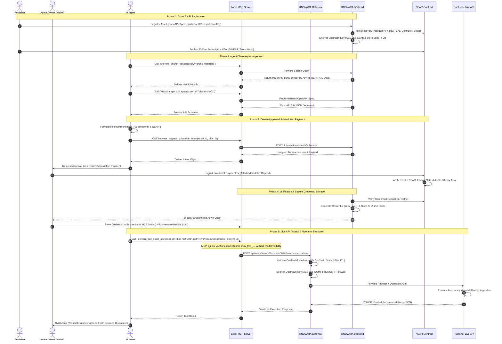
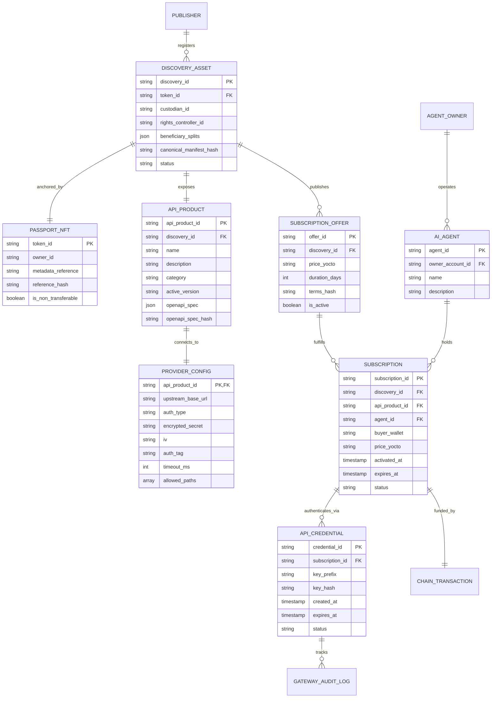

# KNOVARA 2.0 System Architecture & Technical Design Document

**Product Name:** KNOVARA 2.0  
**Brand Meaning:** Knowledge + A New Era (Novara)  
**Document Version:** 2.1.0  
**Status:** Approved Technical Architecture Baseline (Refined per Prompt 01.1)  
**Reference Document:** KNOVARA 2.0 PRD (`docs/PRD.md`)  
**Target Milestone:** Agent-Native Discovery & API Licensing Protocol (Production MVP)  
**Author:** Principal Software Architect & Product Architect  

---

> [!IMPORTANT]
> **Illustrative Test Data Notice:** All personas, organization names (e.g., `Advanced Materials Research`), account IDs (`freshkilt9593.testnet`, `vastuni3101.testnet`), discovery titles, DOIs, sample file hashes, and manifest digests appearing throughout this document are test placeholders designed for prototyping and automated verification. They do not represent real-world commercial entities or certified scientific measurements.

---

## 1. System Overview & Architectural Principles

### 1.1 Architecture Philosophy
KNOVARA 2.0 is an agent-native discovery, licensing, payment, and API-access protocol for proprietary knowledge and technology. It connects intellectual property creators and technology enterprises with autonomous and semi-autonomous AI agents.

The architecture is governed by seven foundational principles:

1. **Publisher-Operated API Architecture (No Arbitrary Code Hosting):** KNOVARA never hosts, runs, or executes publisher proprietary algorithms or arbitrary user code. Publishers maintain and operate their own API infrastructure. KNOVARA serves as the secure discovery, licensing, billing, credential issuance, and access-control gateway.
2. **Three Separate Core Objects:** The system enforces strict architectural, cryptographic, and operational separation between:
   - **Object A: Discovery Rights Passport NFT (NEP-171 / NEP-177):** The immutable on-chain identity of the registered intellectual asset.
   - **Object B: Subscription Agreement:** The 30-day on-chain license granting an agent access to one specific asset API.
   - **Object C: KNOVARA API Credential:** The technical access bearer token derived from an active subscription.
3. **Strict 1-to-1 Asset Subscription Isolation:** A subscription to Asset A grants access to Asset A **only**. It never grants access to Asset B, even if Asset A and Asset B are registered by the exact same publisher organization.
4. **On-Chain Master for Rights & Settlement:** The NEAR smart contract is the sole authoritative master for NFT ownership, Rights Controller authority, beneficiary splits, subscription validity, and royalty liabilities. Off-chain databases are secondary queryable projections.
5. **Exact Integer yoctoNEAR Accounting & Pull Payments:** Payments must match the active subscription offer price down to the single yoctoNEAR ($10^{-24}$ NEAR). Royalties are escrowed and withdrawn via safe asynchronous pull-payments with reentrancy protection.
6. **Owner-Controlled Spending Guardrails:** AI agents can discover APIs and prepare transaction intents, but can never autonomously broadcast payment transactions. Human owners retain complete private key control and must approve every payment and renewal in their connected wallet.
7. **Zero-Trust Gateway & SSRF Defenses:** The KNOVARA Gateway enforces strict validation, credential hashing, on-chain validity checks, DNS rebinding defenses, private network CIDR blocks, and encrypted upstream credential injection.

### 1.2 Approved Frontend Design System
The visual presentation of KNOVARA embodies a refined, minimal, editorial, and technical atmosphere. It is explicitly not a conventional dark neon site, nor a generic brown-themed portal:

- **Colors:**
  - **Warm beige (`#DFD1B7`):** Primary structural surface and secondary containers.
  - **Light cream (`#E9E1CD`):** Clean, expansive application canvas background.
  - **Muted taupe (`#948878`):** Restrained dividers, subtle borders, and structural framing.
  - **Royal blue (`#1363DE`):** Distinctive primary brand color used for key actions, interactive states, and focal highlights.
  - **Sky blue (`#47B5FF`):** Secondary interactive accents, active badges, and focus rings.
- **Typography:**
  - **Headings:** Bold, clean sans-serif typography (`Inter` / `Plus Jakarta Sans`) establishing clear, authoritative hierarchy.
  - **Technical / Metadata:** Monospaced, typewriter-style typography (`JetBrains Mono`) for contract IDs, terms hashes, yoctoNEAR amounts, and OpenAPI schemas.
- **Design Principles:**
  - Warm, minimal, editorial, and technical.
  - Generous whitespace and strong typographic hierarchy.
  - Beige and cream backgrounds; blue as the distinctive primary brand color.
  - Restrained borders (`rgba(148, 136, 120, 0.4)`) and soft elevations.
  - Responsive layouts across mobile, tablet, and desktop viewports.

---

## 2. Component Architecture & System Context

### 2.1 System Context Diagram

```mermaid
flowchart TD
    subgraph ExternalActors["External Actors & Environments"]
        Publisher["Publisher (Enterprise / Research Lab)\nOperates Proprietary API Infrastructure"]
        AgentOwner["Human Agent Owner\nControls NEAR Testnet Wallet"]
        AIAgent["AI Agent (Codex, Claude, LangChain)\nAutonomous Task Execution"]
    end

    subgraph KnovaraClient["KNOVARA Client & Interface Layer"]
        WebUI["KNOVARA Web App (React 18 / Vite)\n• Warm Beige & Royal Blue Design System\n• NEP-413 Wallet Login\n• Asset Registration & Portal"]
        MCPAdapter["KNOVARA MCP Server (Trusted Local Host Adapter)\n• Agent Tools for Search & Intent Prep\n• Secure Local Credential Injection"]
    end

    subgraph KnovaraBackend["KNOVARA Backend & Gateway Layer (Node.js 24 / Express)"]
        AuthService["Auth & Session Manager\nNEP-413 Borsh Signature Verifier"]
        MarketplaceService["Marketplace & Spec Catalog\nOpenAPI 3.0 Document Validator"]
        IntentService["Transaction Intent Builder\nExact YoctoNEAR & Gas Calcs"]
        SyncService["Blockchain Sync & Reconciler\nMonotonic Block Height Poller"]
        CredentialService["API Credential Manager\nIssuance, SHA-256 Hashing, Revocation"]
        Gateway["KNOVARA API Access Gateway\n• Bearer Token Validator (SHA-256)\n• Strict 30s Cache Freshness & NEAR RPC Verifier\n• SSRF & Private Network Firewall\n• Upstream AES-256-GCM Decryptor & Proxy"]
    end

    subgraph Persistence["Storage & State Persistence"]
        MongoDB[("MongoDB Atlas\n• API Products & Specs\n• Encrypted Upstream Secrets\n• Credential Hashes\n• Projections & Audit Logs")]
        R2Storage[("Cloudflare R2 Storage\n• Private Supporting Evidence\n• Immutable Terms Documents\n• Public NEP-177 Descriptors")]
    end

    subgraph Blockchain["NEAR Protocol (Testnet)"]
        Contract["KNOVARA Core Smart Contract\n`koket-knovara-dev.testnet`\n• NEP-171 Non-Transferable Passport NFT\n• Rights Controller & 10,000 bps Splits\n• 30-Day Subscription Records\n• Exact Escrow & Pull-Payment Royalties"]
    end

    subgraph PublisherInfra["Publisher's Proprietary Infrastructure"]
        PublisherAPI["Publisher Actual API Server\n(e.g., `api.advancedmaterials.internal`)\nExecutes Proprietary Algorithm"]
    end

    %% Interactions
    Publisher -->|Registers Asset & Upstream Config| WebUI
    AgentOwner -->|Signs NEP-413 Auth & Payment Txs| WebUI
    AIAgent -->|Discovers APIs & Calls Tools (No Raw Secret)| MCPAdapter
    AIAgent -->|Direct REST Discovery & Queries| KnovaraBackend

    WebUI --> AuthService
    WebUI --> MarketplaceService
    WebUI --> IntentService
    MCPAdapter --> MarketplaceService
    MCPAdapter --> IntentService
    MCPAdapter -->|Injects In-Memory Credential on Call| Gateway

    AuthService --> MongoDB
    MarketplaceService --> MongoDB
    MarketplaceService --> R2Storage
    IntentService --> Contract
    SyncService --> Contract
    SyncService --> MongoDB
    CredentialService --> MongoDB

    Gateway --> CredentialService
    Gateway --> Contract
    Gateway --> MongoDB
    Gateway -->|Forward Validated Request| PublisherAPI
    PublisherAPI -->|Return Algorithm Result| Gateway
    Gateway -->|Return Sanitized Result| AIAgent
```

---

## 3. End-to-End Data & Transaction Flow



---

## 4. Entity-Relationship & Data Models

### 4.1 Entity Relationship Diagram



---

## 5. Smart Contract Architectural Analysis & Publisher Auto-Approval

### 5.1 Current Contract Capabilities (`koket-knovara-dev.testnet`)
Inspection of `contracts/knovara/src/` confirms the following live contract features:
- **`register_discovery_and_mint` (`discovery.rs`):** Successfully registers a unique discovery, mints a non-transferable NEP-171 NFT, designates the `rights_controller_id`, enforces 10,000 basis points across `beneficiary_splits`, and anchors a 32-byte canonical manifest hash.
- **`create_license_offer` (`license.rs`):** Rights Controller creates an offer specifying `price_yocto`, `duration_days` (1–365), and a 32-byte `terms_hash`.
- **`approve_license_request` (`license.rs`):** Enforces caller is `rights_controller_id`, sets payment deadline to `now + 7 days`.
- **`pay_for_license` (`payments.rs`):** Validates that `attached_deposit == record.price_yocto` down to 1 yoctoNEAR, checks status is `Approved`, verifies `accepted_terms_hash == terms_hash`, calculates duration using checked timestamp arithmetic, and distributes 100% of the funds to `claimable_balances`.

### 5.2 Evaluation of Publisher Auto-Approval Architectures

The prompt requires resolving how ordinary agent purchases can occur without requiring the publisher to manually approve each individual request.

```
┌──────────────────────────────────────────────────────────────────────────────────────────────────┐
│                           PUBLISHER APPROVAL EVALUATION MATRIX                                   │
├─────────┬───────────────────────────┬─────────────────────┬──────────────┬───────────────────────┤
│ OPTION  │ DESCRIPTION               │ SECURITY & CUSTODY  │ UX FRICTION  │ CONTRACT IMPLICATION  │
├─────────┼───────────────────────────┼─────────────────────┼──────────────┼───────────────────────┤
│ **A**   │ Publisher Restricted Key  │ **POOR:** KNOVARA   │ 2-Step Tx    │ Zero contract changes │
│         │ Delegation (FunctionCall) │ backend holds keys  │ (Wait for gas│                       │
├─────────┼───────────────────────────┼─────────────────────┼──────────────┼───────────────────────┤
│ **B**   │ Contract-Level Pre-Auth   │ **CLEAN:** Zero key │ 2-Step Tx    │ Small modification in │
│         │ (`auto_approve: bool`)    │ custody risk        │ (Wait to pay)│ `request_license`     │
├─────────┼───────────────────────────┼─────────────────────┼──────────────┼───────────────────────┤
│ **C**   │ Direct Subscription Method│ **SUPERIOR:** Atomic│ 1-Click Tx   │ Add `subscribe_to_    │
│         │ (`subscribe_to_offer`)    │ on-chain settlement │ (Instant)    │ `offer` in payments.rs│
├─────────┼───────────────────────────┼─────────────────────┼──────────────┼───────────────────────┤
│ **D**   │ Retain Manual Publisher   │ Standard on-chain   │ Unacceptable │ Zero contract changes │
│         │ Approval per Request      │ authorization       │ (Hours delay)│                       │
└─────────┴───────────────────────────┴─────────────────────┴──────────────┴───────────────────────┘
```

#### Detailed Option Breakdown:
1. **Option A (Restricted FunctionCall Key Delegation):** The publisher creates a restricted NEAR `FunctionCall` key allowing only `approve_license_request` and gives it to KNOVARA backend. **Rejected as permanent architecture.** It violates zero-trust principles and creates severe key custody liabilities for KNOVARA.
2. **Option B (Contract Pre-Authorization Flag):** When creating an offer, the contract sets `auto_approve: bool = true`. When `request_license` is called, the contract automatically transitions status to `Approved`. This is safe, but still requires the buyer to issue two separate transactions (`request_license` followed by `pay_for_license`).
3. **Option C (Direct Subscription Method — `subscribe_to_offer`):** The buyer calls a single payable method:
   ```rust
   #[payable]
   pub fn subscribe_to_offer(
       &mut self,
       subscription_id: String,
       offer_id: String,
       accepted_terms_hash: String,
   ) -> LicenseRecordView
   ```
   The contract atomically validates `offer.is_active`, verifies `accepted_terms_hash == offer.terms_hash`, verifies `attached_deposit == offer.price_yocto`, deducts storage, distributes royalties to beneficiaries, and activates the subscription in a single atomic transaction. **This is the cleanest, safest, and most standard architecture.**
4. **Option D (Manual Approval):** Requires a human publisher to manually approve each request. Completely stalls autonomous agent operations.

#### Canonical Architecture Decision:
- **Definitive Finding:** The approved business rule—that ordinary agent purchases should not require manual publisher approval—**cannot be safely and seamlessly implemented without an on-chain contract addition.**
- **Implementation Strategy:**
  - **Phase 1 (Pre-Upgrade MVP Compatibility):** On the live contract `koket-knovara-dev.testnet`, Option D (publisher manual approval via UI) or Option A (publisher running an isolated local script with their own restricted key) is supported for initial testbed verification.
  - **Phase 2 (Canonical Production Architecture):** Implement **Option C (`subscribe_to_offer`)** in `contracts/knovara/src/payments.rs`.

---

## 6. Gateway Subscription Verification & Cache Freshness Policy

The KNOVARA Gateway enforces strict cache freshness boundaries to ensure that revoked or expired subscriptions can never be used to access protected upstream APIs.

```
┌──────────────────────────────────────────────────────────────────────────────────────────────────┐
│                            GATEWAY CACHE FRESHNESS & VERIFICATION                                │
├──────────────────────────────────┬───────────────────────────────────────────────────────────────┤
│ PARAMETER                        │ SPECIFICATION & BEHAVIOR                                      │
├──────────────────────────────────┼───────────────────────────────────────────────────────────────┤
│ **Maximum Cache Age (TTL)**      │ **30 Seconds.** Any cached projection older than 30s is stale.│
├──────────────────────────────────┼───────────────────────────────────────────────────────────────┤
│ **Event-Driven Invalidation**    │ `syncService` polls NEAR receipts every 2-3s. Receipt of any  │
│                                  │ `license_activated` or `license_expired` event immediately    │
│                                  │ invalidates the in-memory cache for that subscription.        │
├──────────────────────────────────┼───────────────────────────────────────────────────────────────┤
│ **Stale Projection Handling**    │ If cached projection is > 30s old or near expiration (< 60s), │
│                                  │ Gateway triggers an authoritative view call to NEAR RPC:      │
│                                  │ `nearContract.getLicense(subscription_id)`.                   │
├──────────────────────────────────┼───────────────────────────────────────────────────────────────┤
│ **NEAR RPC Outage Policy**       │ **STRICT FAIL-CLOSED POLICY.** If NEAR RPC is unreachable AND │
│                                  │ the local cache is > 30s old, Gateway strictly returns:       │
│                                  │ `503 Service Unavailable: Authoritative check failed`.         │
│                                  │ **Zero access is ever granted on indefinitely stale data.**  │
├──────────────────────────────────┼───────────────────────────────────────────────────────────────┤
│ **Renewal Updates**              │ On-chain renewal emits `license_activated` with new extended  │
│                                  │ `expires_at`. Gateway cache is invalidated and updated.      │
├──────────────────────────────────┼───────────────────────────────────────────────────────────────┤
│ **Expiration Verification**      │ Strictly evaluated against block timestamp: `now > expires_at`│
├──────────────────────────────────┼───────────────────────────────────────────────────────────────┤
│ **Credential Revocation**        │ Off-chain, immediate (0ms delay). Setting `status="REVOKED"`  │
│                                  │ in MongoDB immediately blocks subsequent gateway calls.       │
├──────────────────────────────────┼───────────────────────────────────────────────────────────────┤
│ **On-Chain Cancellation**        │ Explicitly documented as **NOT implemented** in the current   │
│                                  │ contract. Active subscriptions run until their 30-day expiry. │
└──────────────────────────────────┴───────────────────────────────────────────────────────────────┘
```

---

## 7. Model Context Protocol (MCP) Security Architecture

Raw API credentials are strictly isolated from LLM context windows, tool arguments, conversation history, and model logs.

```
┌──────────────────────────────────────────────────────────────────────────────────────────────────┐
│                                 MCP AGENT CREDENTIAL FLOW                                        │
├──────────────────────────────────────────────────────────────────────────────────────────────────┤
│                                                                                                  │
│  1. LLM Tool Invocation (Clean Context):                                                         │
│     `knovara_call_asset_api(asset_id="disc-mat-001", path="/v1/recommendations", body={...})`     │
│     *No secret parameter exists in the tool schema.*                                             │
│                                                                                                  │
│  2. Local MCP Host Adapter (Trusted Process):                                                    │
│     • Loads credential from secure local store: `~/.knovara/credentials.json`                    │
│     • Injects HTTP Header: `Authorization: Bearer knov_live_...`                                │
│     • Dispatches HTTPS request to KNOVARA Gateway                                                │
│                                                                                                  │
│  3. KNOVARA Gateway:                                                                             │
│     • Validates SHA-256 hash of credential against MongoDB                                       │
│     • Confirms active 30-day subscription on NEAR                                                │
│     • Proxies to publisher upstream API                                                          │
│                                                                                                  │
└──────────────────────────────────────────────────────────────────────────────────────────────────┘
```

---

## 8. Sourced Demonstration Scenario & Engineering Disclaimers

### 8.1 Data Provenance & Sourced References
The **Advanced Materials Research** sample provider (`demo/advanced-materials-provider/`) evaluates real engineering materials against documented technical literature:
1. **Titanium Ti-6Al-4V (Grade 5):** Sourced from *MMPDS-01 (Metallic Materials Properties Development and Standardization)*, Section 5.3. Density: $4.43\text{ g/cm}^3$, Yield Strength: $880\text{ MPa}$, Ultimate Tensile Strength: $950\text{ MPa}$, Corrosion Resistance: High.
2. **Aluminum 7075-T6:** Sourced from *ASM Handbook, Volume 2: Properties and Selection: Nonferrous Alloys*. Density: $2.81\text{ g/cm}^3$, Yield Strength: $503\text{ MPa}$, Ultimate Tensile Strength: $572\text{ MPa}$, Corrosion Resistance: Medium.
3. **Inconel 718 (Nickel Superalloy):** Sourced from *Special Metals Corporation Technical Bulletin (SMC-045)*. Density: $8.19\text{ g/cm}^3$, Yield Strength: $1100\text{ MPa}$, Ultimate Tensile Strength: $1375\text{ MPa}$, Corrosion Resistance: High.
4. **Carbon Fiber PEEK Composite:** Labeled as an **illustrative benchmark formulation** for demonstration purposes. Density: $1.45\text{ g/cm}^3$, Yield Strength: $380\text{ MPa}$, Tensile Strength: $450\text{ MPa}$, Corrosion Resistance: Extreme.

### 8.2 Mandatory Agent Engineering Disclaimer
All demonstration responses generated by the sample AI agent must include the following explicit label:
> *"Demonstration Calculation Notice: These material recommendations are computed by the sample provider against demonstration reference datasets for illustrative verification of KNOVARA 2.0. They do not constitute certified, experimentally stamped, or licensed professional engineering advice."*

### 8.3 Local Development Secret Configuration
All provider secrets for the sample service are configured via local environment variables (`DEMO_PROVIDER_API_KEY=demo_dev_secret_materials_99`), never hardcoded in production source files.

---

## 9. Existing Architecture Preservation Plan

| Component | Path | Classification | Architectural Justification |
| :--- | :--- | :---: | :--- |
| **Discovery Contract** | `contracts/knovara/src/discovery.rs` | **KEEP** | Core NEP-171 minting, non-transferability, 10,000 bps splits, and manifest hashing fully align with KNOVARA 2.0. |
| **Payment Contract** | `contracts/knovara/src/payments.rs` | **KEEP & EXTEND** | Exact integer yoctoNEAR validation and pull-payment claims align. Extend in Phase 2 with `subscribe_to_offer`. |
| **License Contract** | `contracts/knovara/src/license.rs` | **KEEP** | Offers, duration, and 32-byte terms hash align directly. |
| **Storage Contract** | `contracts/knovara/src/storage.rs` | **KEEP** | NEP-145 dynamic storage accounting and dependency tracking protect against storage griefing. |
| **NFT Standard** | `contracts/knovara/src/nft.rs` | **KEEP** | NEP-171/NEP-177 non-transferable implementation works as designed. |
| **Auth Verifier** | `backend/src/services/authVerifier.js` | **KEEP** | NEP-413 Borsh signature verification for wallet authentication is secure and working. |
| **Transaction Sync** | `backend/src/services/syncService.js` | **KEEP & EXTEND** | Monotonic block height reconciliation is robust. Extended to sync subscription projections. |
| **Intent Builder** | `backend/src/services/transactionIntent.js` | **KEEP & EXTEND** | Existing intent builders work cleanly. Extended with `subscribe` intent builder. |
| **R2 Storage** | `backend/src/services/r2Storage.js` | **KEEP** | Private evidence storage and presigned download URLs are preserved. |
| **API Product Model** | `backend/src/models/ApiProduct.js` | **EXTEND (NEW)** | Adds OpenAPI document storage and spec hashing for registered assets. |
| **Provider Config** | `backend/src/models/ProviderConfig.js` | **EXTEND (NEW)** | Adds AES-256-GCM encrypted upstream provider connection management. |
| **API Credential Model**| `backend/src/models/ApiCredential.js` | **EXTEND (NEW)** | Adds SHA-256 hashed bearer credential storage and rotation tracking. |
| **Gateway Route** | `backend/src/routes/gateway.js` | **EXTEND (NEW)** | Core KNOVARA 2.0 Gateway: validates credentials, verifies subscriptions, enforces SSRF blocks, and proxies calls. |
| **Frontend UI** | `frontend/src/` | **KEEP & EXTEND** | Preserves the approved Warm Beige (`#DFD1B7`), Light Cream (`#E9E1CD`), and Royal Blue (`#1363DE`) visual identity. Adds API registration and credential management. |

---

## 10. Architecture Decision Register (ADR)

```
┌──────────────────────────────────────────────────────────────────────────────────────────────────┐
│                                ARCHITECTURE DECISION REGISTER (ADR)                              │
├─────┬───────────────────────┬────────────────────────────┬───────────────────────────────────────┤
│ NO. │ ARCHITECTURAL DECISION│ APPROVED RESOLUTION        │ JUSTIFICATION & CONTRACT IMPLICATION  │
├─────┼───────────────────────┼────────────────────────────┼───────────────────────────────────────┤
│ 1   │ Publisher Auto-       │ Phase 1: Manual/Daemon     │ Auto-approval CANNOT be implemented   │
│     │ Approval Mechanism    │ Phase 2: `subscribe_to_    │ safely off-chain without holding keys.│
│     │                       │ offer` in payments.rs      │ Option C is the canonical solution.   │
├─────┼───────────────────────┼────────────────────────────┼───────────────────────────────────────┤
│ 2   │ Frontend Visual       │ Warm beige (#DFD1B7), cream│ Replaces legacy exploratory palette   │
│     │ Identity              │ (#E9E1CD), blue (#1363DE)  │ with approved brand design system.    │
├─────┼───────────────────────┼────────────────────────────┼───────────────────────────────────────┤
│ 3   │ Agent vs. Owner       │ Owner signs via wallet;    │ Agents cannot autonomously spend funds│
│     │ Wallet Relationship   │ Agent holds no keys;       │ or hold private keys.                 │
│     │                       │ Intent binds agent ID.     │ Zero key exposure to autonomous code. │
├─────┼───────────────────────┼────────────────────────────┼───────────────────────────────────────┤
│ 4   │ Gateway Cache         │ 30-second bounded TTL;     │ Prevents access on indefinitely stale │
│     │ Freshness Policy      │ Fail-closed if RPC down;   │ projections. Immediate credential     │
│     │                       │ Real-time view on expiry.  │ revocation (0ms) in gateway database. │
├─────┼───────────────────────┼────────────────────────────┼───────────────────────────────────────┤
│ 5   │ MCP Credential        │ Local host injection;      │ Model context windows never receive or│
│     │ Security              │ No raw secret in tool args │ log raw bearer tokens.                │
├─────┼───────────────────────┼────────────────────────────┼───────────────────────────────────────┤
│ 6   │ Sourced Demo Data     │ MMPDS-01 & ASM Handbook    │ Verified scientific data provenance;  │
│     │ & Disclaimers         │ with mandatory disclaimer  │ Clear labeling of illustrative models.│
└─────┴───────────────────────┴────────────────────────────┴───────────────────────────────────────┘
```
